# StudySeat

스터디카페 좌석 예약 서비스입니다. 지점을 지도에서 찾고, 매장 도면에서 자리를 직접 눌러 예약하고, QR 코드로 입실합니다.


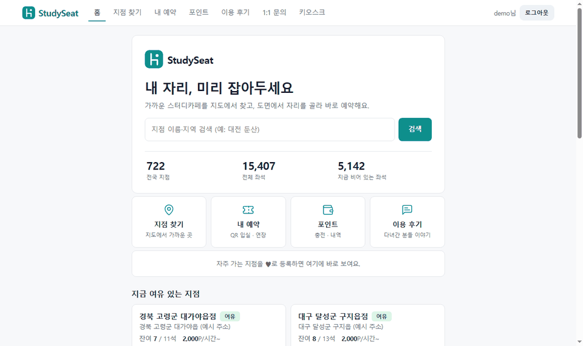

## 목차
1. [프로젝트 소개](#1-프로젝트-소개)
2. [주요 기능](#2-주요-기능)
3. [서비스 화면](#3-서비스-화면)
4. [WBS](#4-wbs)
5. [요구사항 명세서](#5-요구사항-명세서)
6. [기술 스택](#6-기술-스택)
7. [시스템 아키텍처와 유스케이스](#7-시스템-아키텍처와-유스케이스)
8. [ERD와 테이블 명세서](#8-erd와-테이블-명세서)
9. [API 명세서](#9-api-명세서)
10. [동시성과 포인트 처리](#10-동시성과-포인트-처리)
11. [도면 엔진과 혼잡도 통계](#11-도면-엔진과-혼잡도-통계)
12. [테스트 결과](#12-테스트-결과)
13. [트러블슈팅](#13-트러블슈팅)
14. [향후 개선 계획](#14-향후-개선-계획)
15. [정리 자료](#15-정리-자료)

---

## 1. 프로젝트 소개

StudySeat는 스터디카페 좌석 예약 서비스입니다. 전국 지도에서 지점을 찾고, 매장 도면에서 좌석을 직접 골라 예약한 뒤 QR 코드로 입실합니다. 예약, 연장, 취소, 포인트 충전과 환불, 후기와 1:1 문의, 관리자용 혼잡도 대시보드까지 갖췄습니다.

Spring Boot, JPA, Thymeleaf로 만들었고, 전국 지점 약 720곳(256개 시·군·구)과 좌석 약 1만 5천 석의 데이터를 앱이 시작할 때 만들어 줍니다.

### 만들면서 신경 쓴 부분

- 이중 예약 방지: 예약을 1시간 슬롯 행으로 나누고 `(seat_id, slot_start)` 유니크 제약을 걸어서, 겹치는 요청은 DB가 거부합니다. 20명이 동시에 예약해도 1명만 성공합니다.
- 포인트 이중 사용 방지: 회원 행에 비관적 락을 걸고 잔액은 원장 합계로 계산합니다. 같은 예약의 환불이나 적립이 두 번 기록되지 않습니다.
- 도면 엔진: 좌석 수만 주면 벽, 스터디룸, 사물함, 키오스크까지 배치하고, 756가지 조합에서 겹치지 않는지 시험합니다.
- 혼잡도 통계: 매시 집계하고, 서버가 꺼져 있던 구간은 시작할 때 빈 구간만 채웁니다.
- 자동 시험 40개가 통과합니다(동시성 시험 포함).

## 2. 주요 기능

### 이용 흐름

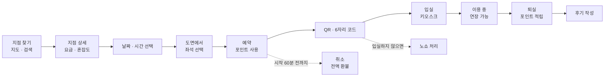

<details>
<summary><b>1. 지점 찾기</b></summary>

전국 지도에서 지점을 찾습니다. 시·도와 시·군·구로 좁히거나 이름으로 검색하고, 잔여석 순이나 거리순으로 정렬합니다. 지도 마커에는 지금 남은 좌석 수가 보이고, 자주 가는 지점은 내 지점으로 등록합니다. 지점마다 운영 시간과 구역별 시간당 요금이 다릅니다(홍대점은 24시간 운영).

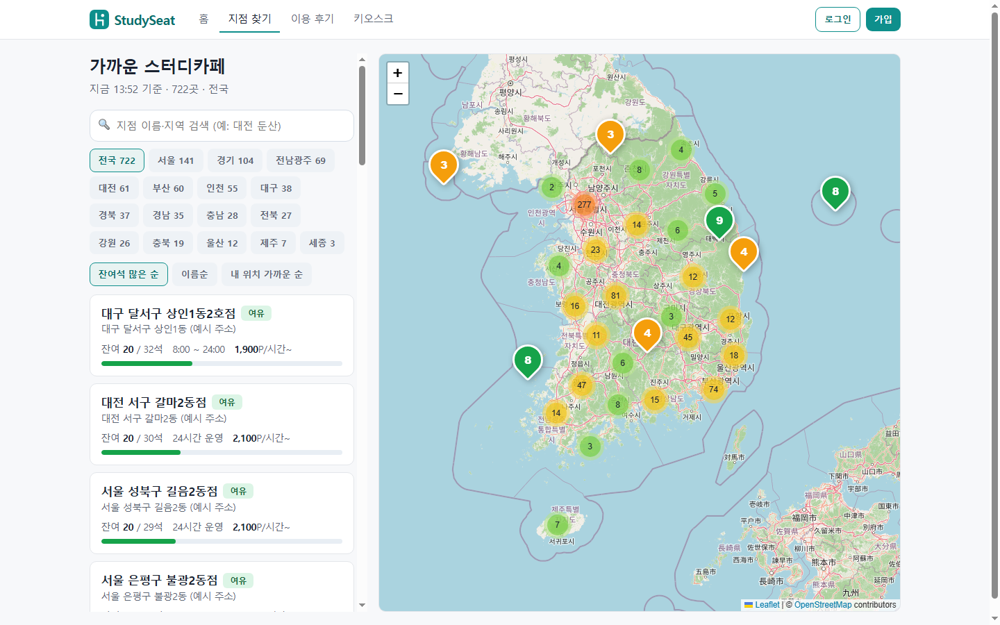
</details>

<details>
<summary><b>2. 도면에서 좌석 예약</b></summary>

날짜와 시간을 고른 뒤 도면에서 자리를 누르면 예약됩니다. 여성 전용, 남성 전용, 월 이용권 회원 전용(고정석), 바로 앞 시간까지 쓰다 비는 자리(퇴실예정석)가 도면에 따로 표시됩니다.

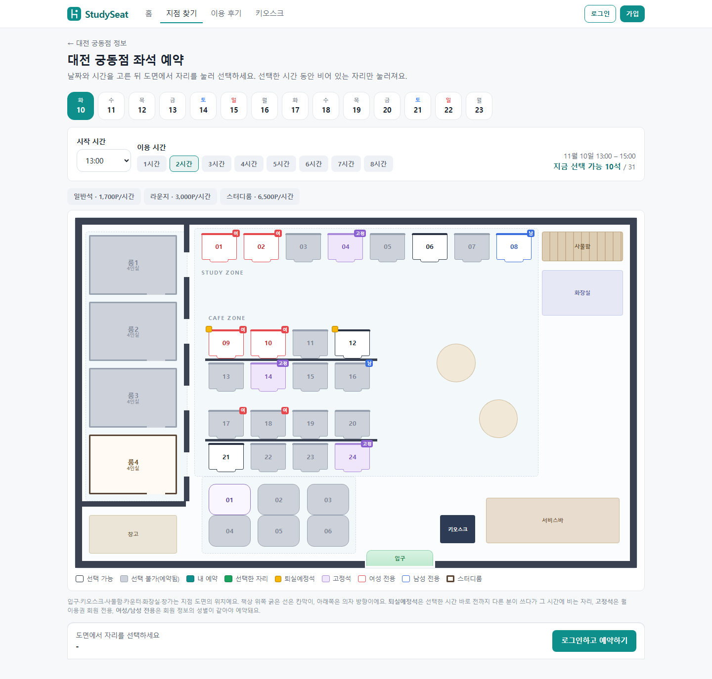
</details>

<details>
<summary><b>3. 입실, 연장, 취소</b></summary>

예약하면 QR과 6자리 코드가 나오고, 키오스크 시뮬레이터에서 코드로 입실과 퇴실을 합니다. 이용 중에는 1~2시간 연장할 수 있고(예약당 한 번), 시작 60분 전까지는 전액 환불로 취소됩니다. 입실하지 않으면 노쇼로 처리되고, 퇴실을 안 눌러도 종료 시각에 자동으로 끝납니다.

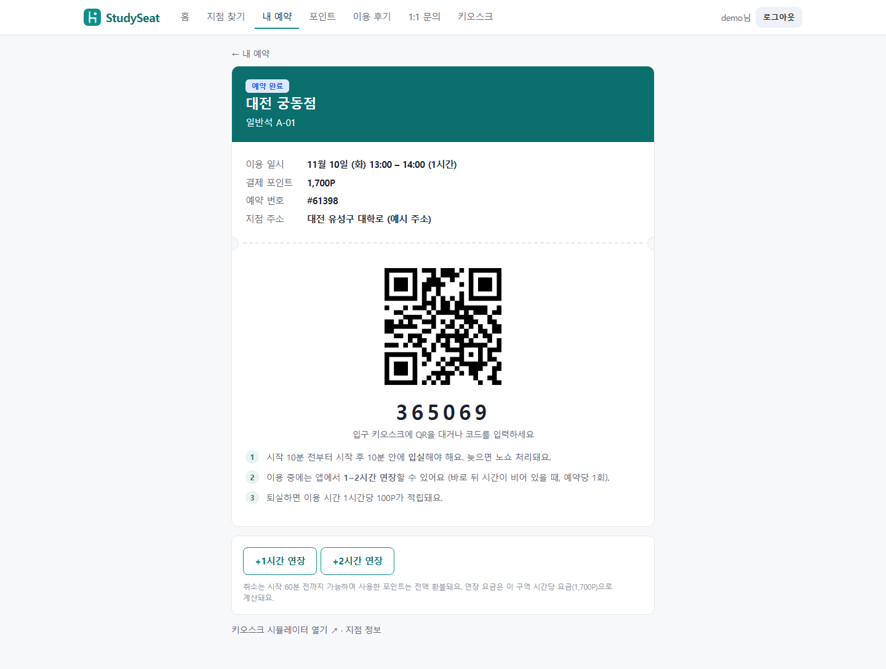 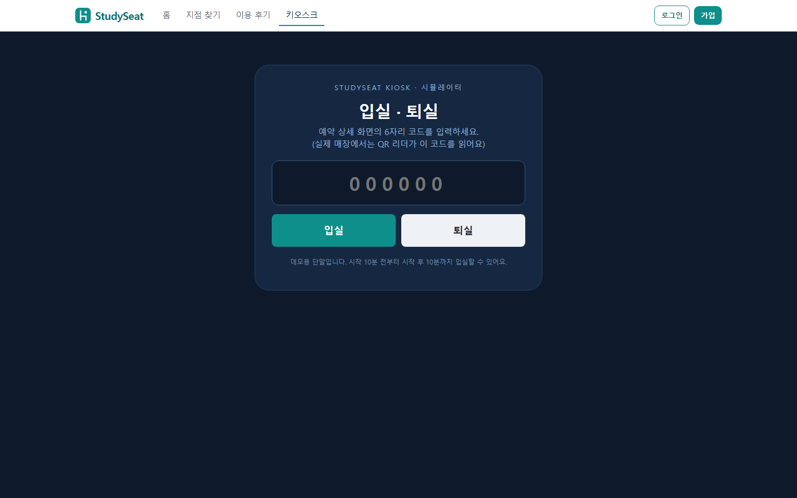
</details>

<details>
<summary><b>4. 포인트</b></summary>

충전하면 금액에 따라 보너스가 붙고(결제는 데모), 예약, 연장, 환불, 적립이 원장에 차례로 쌓입니다.

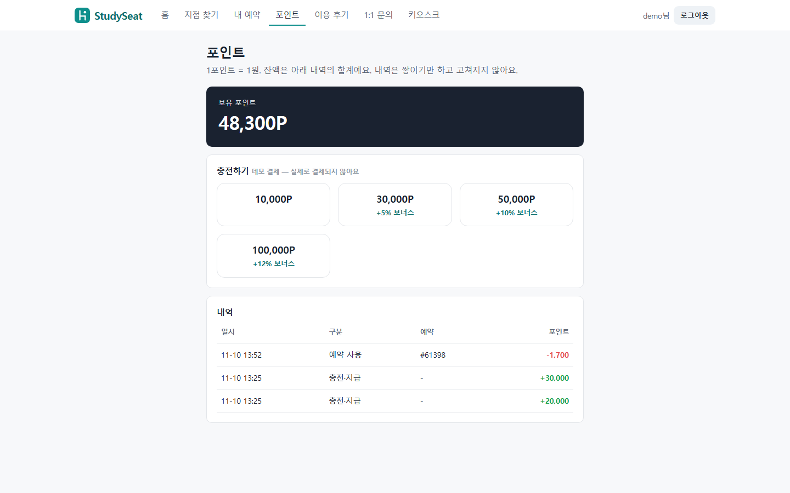
</details>

<details>
<summary><b>5. 후기와 문의</b></summary>

이용을 마친 예약에만 별점 후기를 한 번 쓸 수 있고, 후기 목록은 누구나 보되 작성자 이름은 가립니다. 1:1 문의는 회원이 쓰면 관리자가 답변합니다.
</details>

<details>
<summary><b>6. 관리자</b></summary>

지점 실시간 현황과 구역별 혼잡도 그래프를 보고, 좌석을 끄거나 예약을 강제로 취소하고(환불 포함) 문의에 답합니다. 서버가 꺼져 있던 구간의 통계는 버튼으로 바로 채울 수 있습니다.

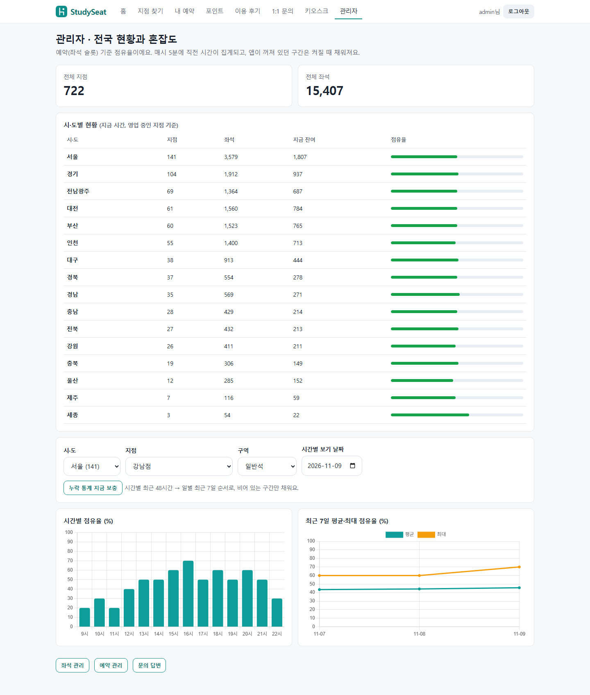
</details>

## 3. 서비스 화면

### 홈
검색창과 전국 지점 수, 지금 비어 있는 좌석 수, 지금 여유 있는 지점, 지역별 지점 수가 나옵니다. 지역 칩이나 검색어는 지점 찾기 지도로 이어집니다.

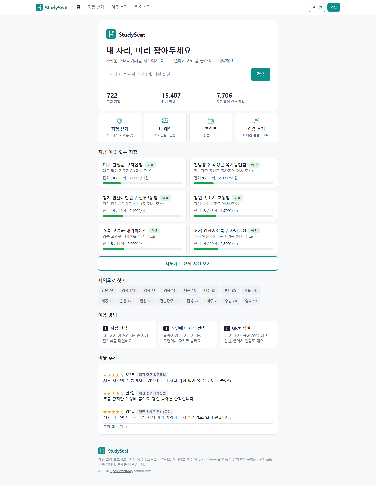

### 지점 찾기와 상세
지도 마커에 남은 좌석 수가 보이고, 가까운 마커끼리는 묶입니다. 지점 상세에서는 요금표, 구역별 지금 잔여, 시간대별 혼잡도(최근 2주 평균), 편의시설, 위치, 후기를 봅니다.

 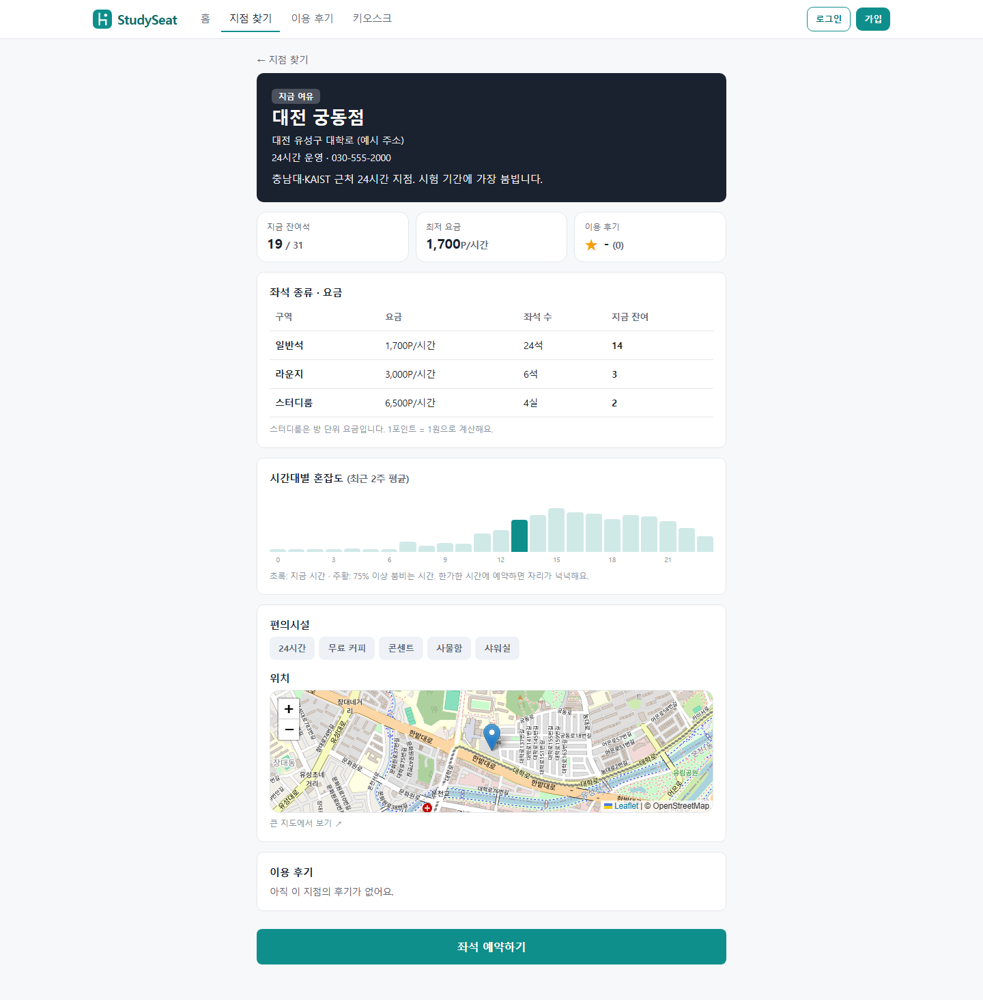

### 도면에서 좌석 선택
지점마다 도면의 구도가 다릅니다. 아래는 홀형(대전 궁동점), 도서관형(건대입구점), 작은 지점(인천 옹진군 대청면점)입니다.

 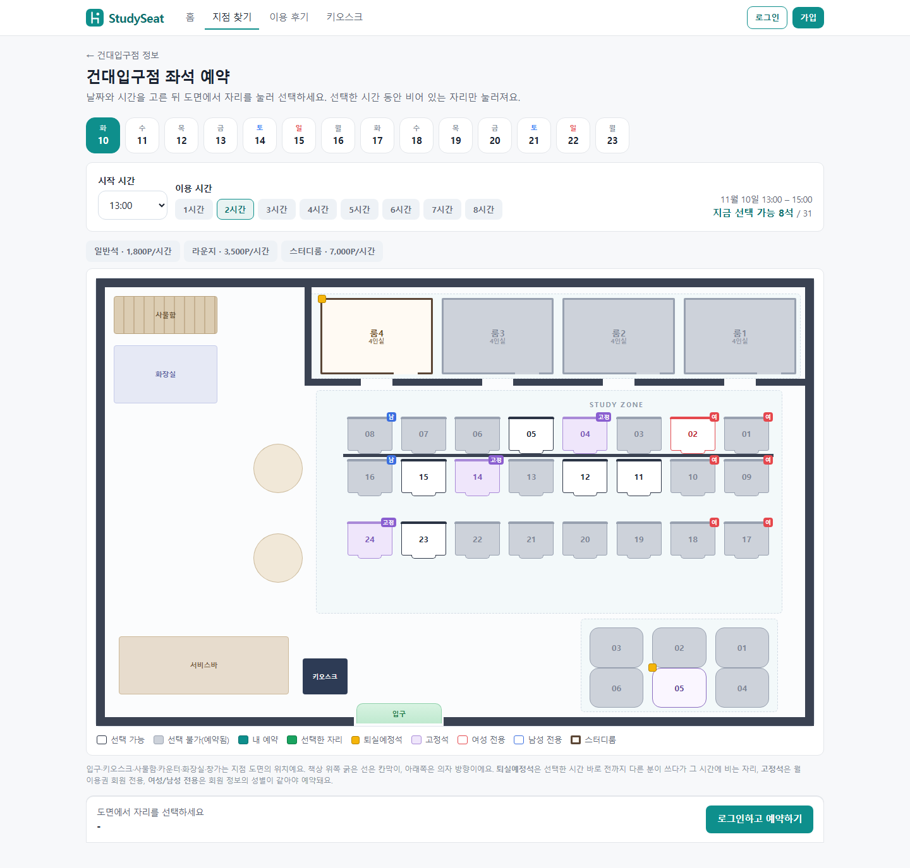 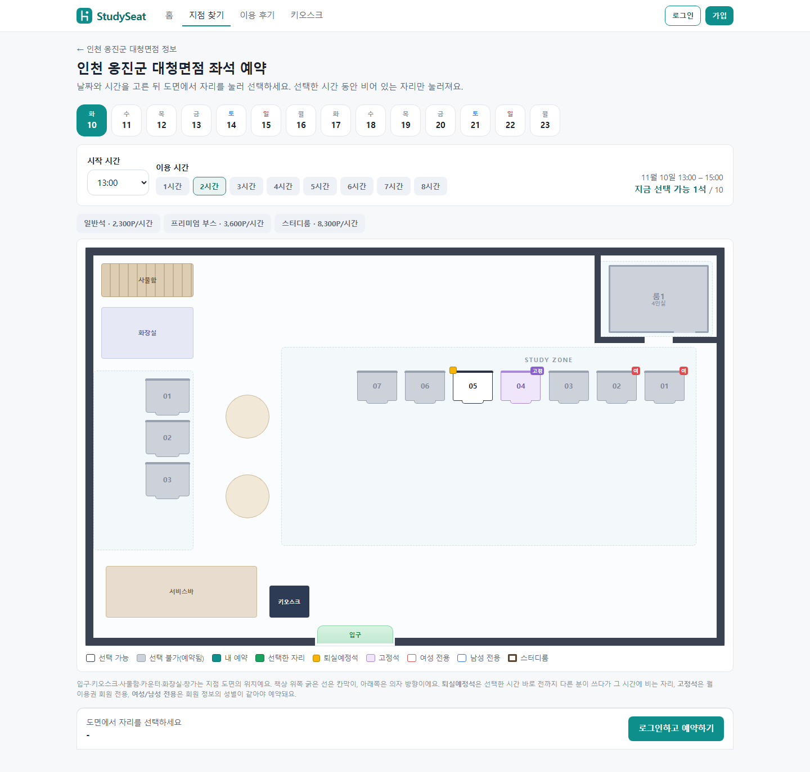

### 예약 완료, 포인트, 키오스크
예약하면 QR과 6자리 코드가 나오고 연장과 취소 버튼이 이어집니다. 포인트는 충전 금액에 따라 보너스가 붙습니다.

  

### 관리자 대시보드
시·도별 현황과 구역별 시간별 막대, 7일 평균·최대 선이 나오고, 누락된 통계를 지금 채우는 버튼이 있습니다.


## 4. WBS

[07_WBS.xlsx](deliverables/07_WBS.xlsx)

<details>
<summary><b>WBS</b></summary>

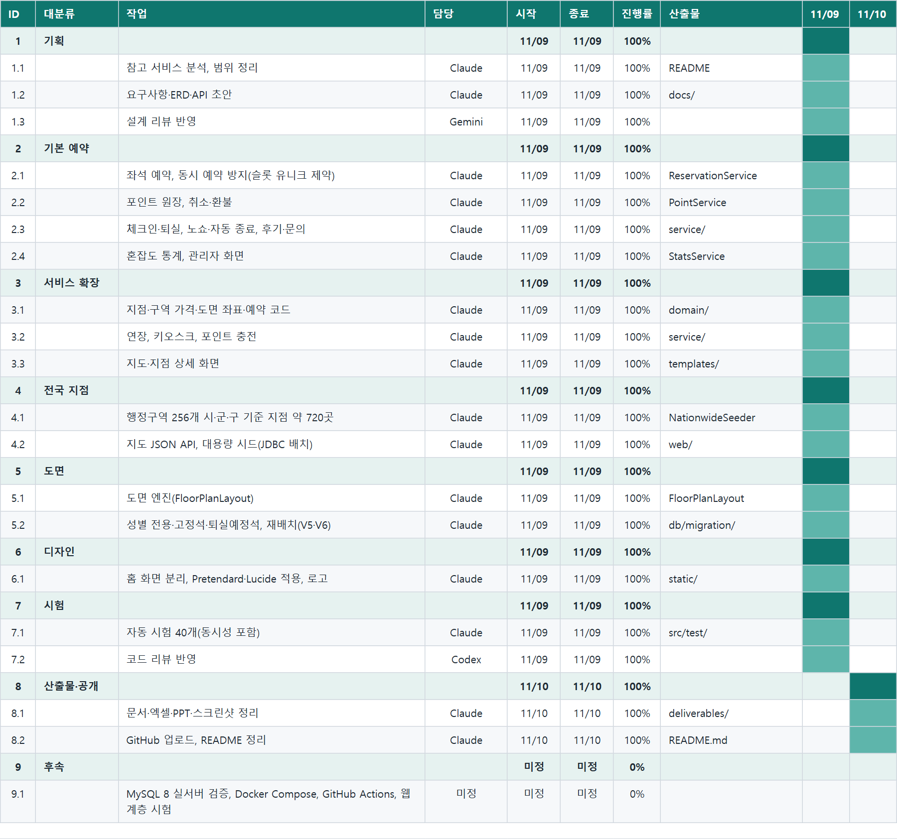

</details>

## 5. 요구사항 명세서

### 요약

| 구분 | 개수 | 예시 | 확인 |
|---|---|---|---|
| 지점·지도 | 5 | 지도에 지점을 마커로 보여주고, 마커·카드에 지금 잔여석과 혼잡 단계(여유/보통/혼잡/영업 종료)를 표시한다 | 3개는 자동 시험으로도 확인 |
| 계정 | 4 | 아이디(영문·숫자·밑줄 4~20자)·비밀번호(8자 이상)로 가입하고 환영 포인트를 지급한다 | 1개는 자동 시험으로도 확인 |
| 좌석·도면 | 6 | 지점 도면에 좌석·스터디룸·입구·카운터를 그리고, 선택한 날짜·시간 구간의 좌석 상태(선택 가능/예약됨/내 … | 4개는 자동 시험으로도 확인 |
| 예약 | 7 | 날짜·시작·이용 시간을 고르고 도면에서 좌석을 눌러 예약한다(정시, 지점 운영 시간 안, 1~8시간, 지난 … | 7개는 자동 시험으로도 확인 |
| 입퇴실·노쇼 | 3 | 예약 완료 시 6자리 코드와 QR을 보여주고, 앱 또는 키오스크(코드 입력)로 입실·퇴실한다 | 3개는 자동 시험으로도 확인 |
| 포인트 | 3 | 잔액은 원장 합계이며, 원장은 쌓기만 한다(충전·보너스·사용·연장·환불·적립) | 2개는 자동 시험으로도 확인 |
| 후기 | 2 | 이용을 마친(DONE) 예약에만 별점(1~5)·후기(500자 이내)를 1회 쓸 수 있다 | 2개는 자동 시험으로도 확인 |
| 문의 | 1 | 회원이 1:1 문의를 등록하고 관리자가 답변하며 회원이 답변을 본다 | 0개는 자동 시험으로도 확인 |
| 혼잡도 통계 | 3 | 구역별 시간별 점유율(예약 슬롯 수 / 사용 가능 좌석 수)을 매시 5분에 직전 시간 기준으로 집계한다(지점… | 1개는 자동 시험으로도 확인 |
| 관리자 | 4 | 지점 실시간 현황, 구역별 시간별 막대·7일 평균/최대 선, 누락 통계 수동 보충 | 1개는 자동 시험으로도 확인 |

[08_요구사항_명세서.xlsx](deliverables/08_요구사항_명세서.xlsx) · [09_기능_명세서_목록.xlsx](deliverables/09_기능_명세서_목록.xlsx)

<details>
<summary><b>요구사항 명세서</b></summary>

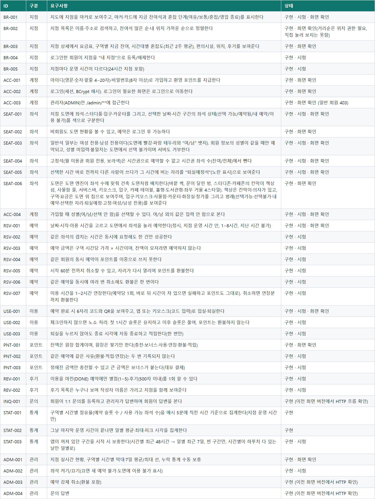

</details>

<details>
<summary><b>정책 값</b></summary>

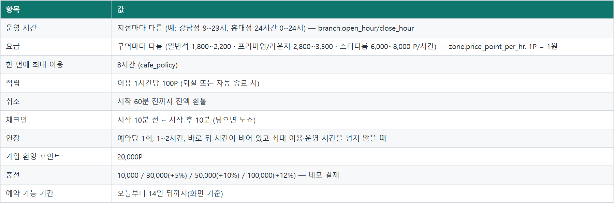

</details>

<details>
<summary><b>기능 명세서</b></summary>


</details>

<details>
<summary><b>사용자별 권한</b></summary>

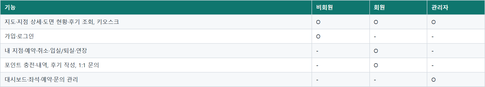

</details>

<details>
<summary><b>예약 상태</b></summary>

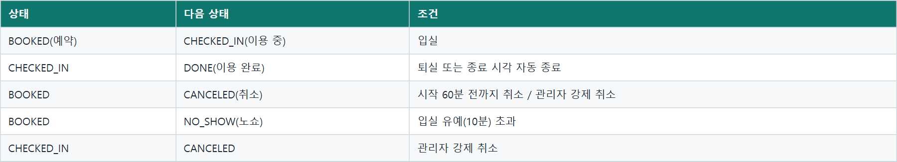

</details>

## 6. 기술 스택

### 백엔드


### 화면


### 데이터


### 시험·빌드


개발은 Windows 10과 JDK 17에서 했고, Docker와 MySQL은 설치되어 있지 않아 H2로 개발했습니다.

## 7. 시스템 아키텍처와 유스케이스

### 유스케이스

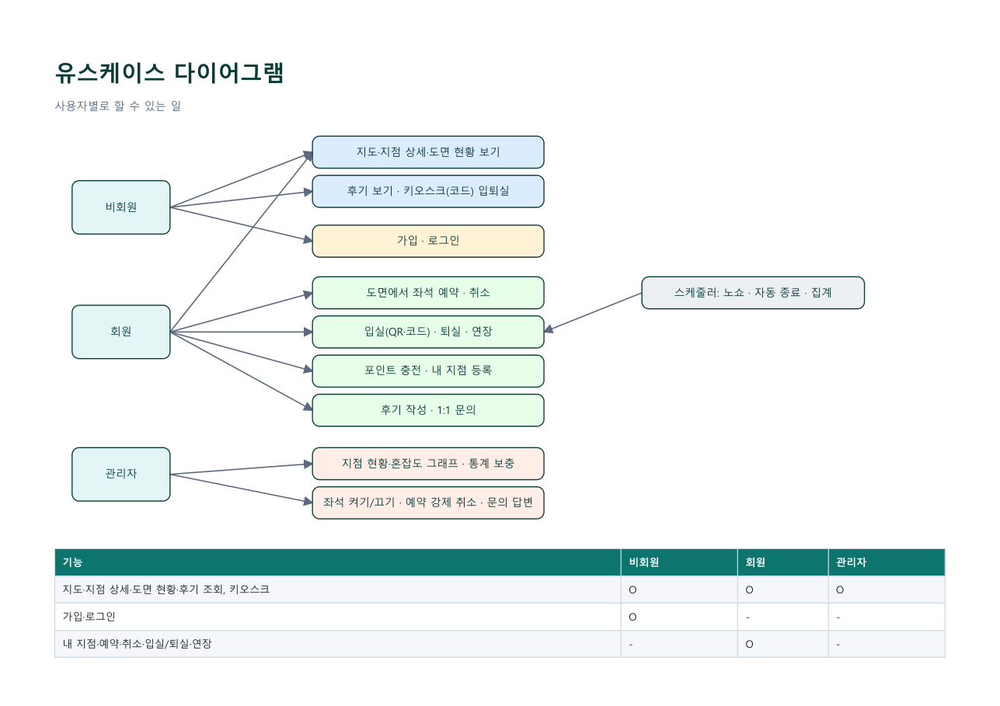

### 시스템 아키텍처

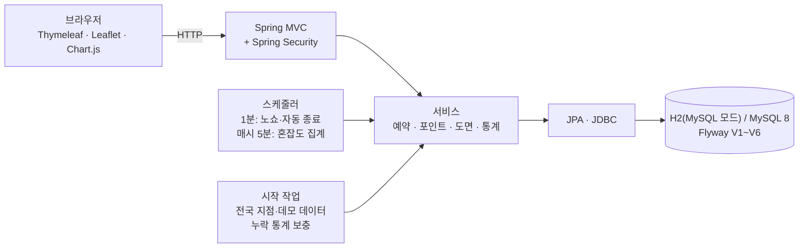

패키지는 `config`(보안, 시계, 스케줄러, 시작 작업), `domain`(엔티티), `repository`, `service`(업무 규칙), `web`(컨트롤러, 도면 변환)으로 나눴습니다. 시간은 `Clock`(Asia/Seoul)을 주입하고 서비스 메서드가 `now`를 인자로 받게 해서, 시험에서 시각을 마음대로 고정할 수 있습니다. 스키마는 Flyway(V1~V6)가 만들고 JPA는 `ddl-auto: validate`로 맞는지만 봅니다. POST 요청은 전부 CSRF 토큰이 필요합니다.

<details>
<summary>스케줄과 시작 작업</summary>

| 작업 | 주기 | 내용 |
|---|---|---|
| 예약 점검 sweep | 1분 | 노쇼 처리, 이용 종료 시각이 지난 이용 자동 종료·적립 |
| 직전 시간 집계 | 매시 5분 | 방금 끝난 시간을 구역별로 집계(지점 운영 시간만), 그날 마지막 운영 시간이면 일별도 집계 |
| 시작 작업 | 앱 시작 시 1회 | (데모) 계정·전국 지점(실제 읍·면·동 위에 가상 지점) 생성·오늘 앞뒤 시간대 예약·지난 3일 통계 합성 → 누락 통계 보충(시간별 48시간 → 일별 7일) |

</details>

[12_시스템·서비스_구성도.pdf](deliverables/12_시스템·서비스_구성도.pdf) · [10_유스케이스_다이어그램.pdf](deliverables/10_유스케이스_다이어그램.pdf)

## 8. ERD와 테이블 명세서

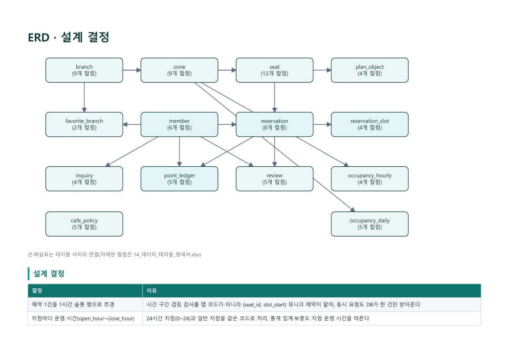

<details>
<summary>ERD (mermaid, 테이블 14개)</summary>

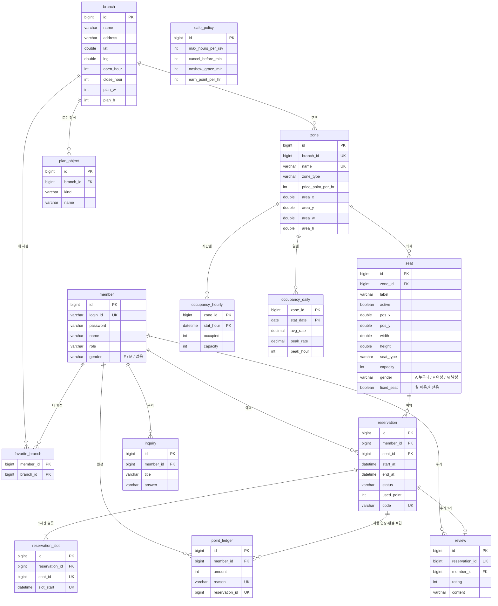

</details>

[14_데이터_테이블_명세서.xlsx](deliverables/14_데이터_테이블_명세서.xlsx)

<details>
<summary><b>컬럼 명세</b></summary>

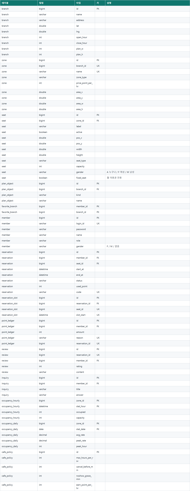

</details>

<details>
<summary><b>제약·인덱스</b></summary>

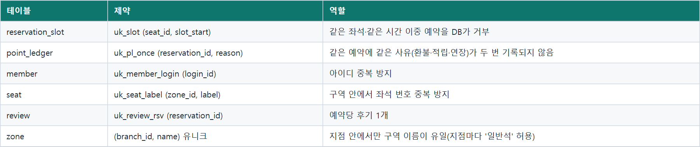

</details>

<details>
<summary><b>관계</b></summary>

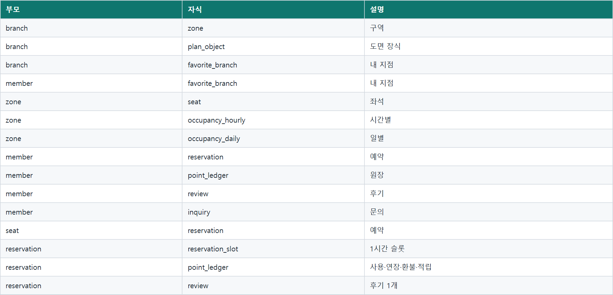

</details>

## 9. API 명세서

[15_API_명세서.xlsx](deliverables/15_API_명세서.xlsx)

<details>
<summary><b>화면(HTML) 경로</b></summary>

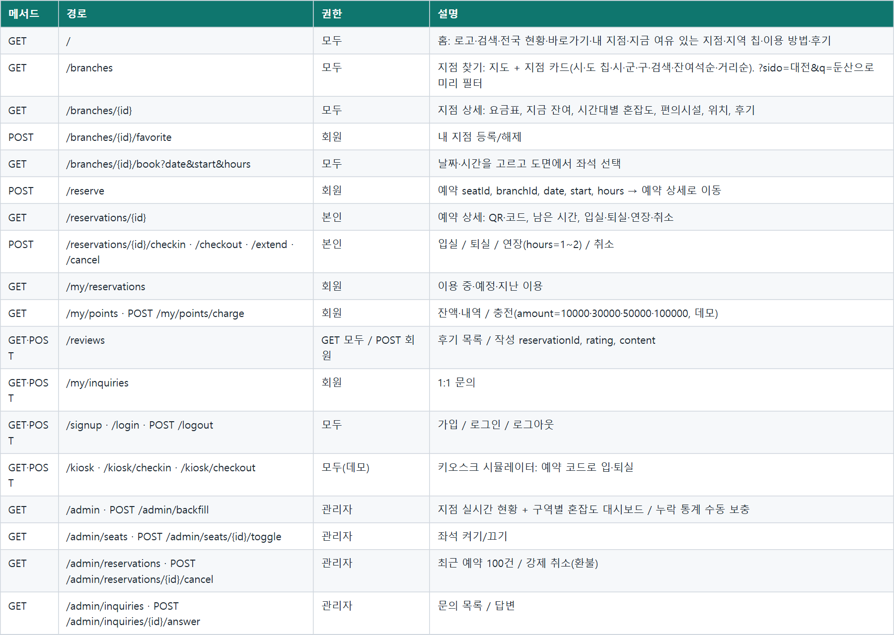

</details>

<details>
<summary><b>JSON 경로</b></summary>

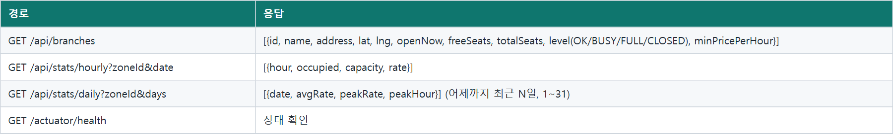

</details>

## 10. 동시성과 포인트 처리

### 동시에 같은 자리를 누르면

예약 한 건을 1시간짜리 슬롯 행으로 나눠 저장하고, `reservation_slot` 테이블에 `(seat_id, slot_start)` 유니크 제약을 걸었습니다. 겹치는 시간이 있는지를 코드로 검사하지 않고, 두 번째 INSERT가 제약에 걸려 실패하게 만든 것입니다. 동시에 들어온 요청도 DB가 한 건만 받아 줍니다.

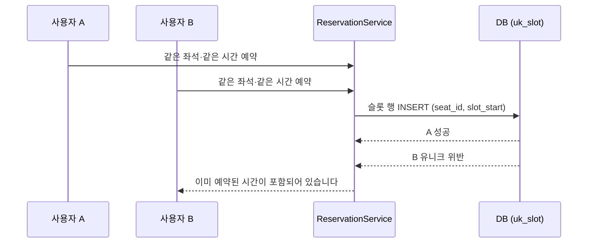

```java
@Transactional
public Reservation reserve(Long memberId, Long seatId, LocalDateTime startAt, int hours, LocalDateTime now) {
    // 회원 락을 트랜잭션 첫 문장으로 잡는다 (MySQL 기본 격리에서 읽기 스냅샷이 먼저 만들어지는 문제 때문)
    Member member = members.findByIdForUpdate(memberId).orElseThrow(...);
    ...
    List<ReservationSlot> rows = new ArrayList<>();
    for (int i = 0; i < hours; i++) {
        rows.add(new ReservationSlot(reservation.getId(), seatId, startAt.plusHours(i)));
    }
    try {
        slots.saveAllAndFlush(rows);   // (seat_id, slot_start) 유니크 제약이 겹침을 거부
    } catch (DataIntegrityViolationException e) {
        throw new SeatTakenException("이미 예약된 시간이 포함되어 있습니다");
    }
    points.use(memberId, reservation.getId(), price, now);
    return reservation;
}
```

시험에서는 같은 좌석, 같은 시간에 20명이 동시에 예약하면 1명이 성공하고 19명이 거부됩니다. 시작 시각이 서로 다른 겹치는 예약 12건을 섞어 돌려도 같은 자리가 두 번 잡힌 경우는 0건이었습니다.

### 포인트는 원장으로

같은 회원이 여러 좌석을 동시에 예약하면 포인트가 이중으로 빠질 수 있습니다. 그래서 `reserve`의 첫 줄에서 회원 행을 비관적 락으로 잠그고, 격리 수준은 READ COMMITTED로 맞췄습니다. 잔액 2,000P로 5개 좌석을 동시에 예약하는 시험에서 1건만 성공하고 잔액은 0이 됩니다. 락을 일부러 일반 조회로 바꿔 보니 이 시험이 실패했고, 되돌리니 다시 통과했습니다. 시험이 정말 문제를 잡는지 확인하려고 한 일입니다.

잔액은 따로 저장하지 않고 `point_ledger`의 합계로 계산합니다. 원장에는 쌓기만 하고(충전, 사용, 연장, 환불, 적립), `(reservation_id, reason)`에 유니크를 걸어서 같은 예약에 환불이나 적립이 두 번 기록되지 않게 했습니다. 같은 예약을 5명이 동시에 취소해도 환불은 한 번만 들어갑니다. 연장은 `EXTEND`로 따로 기록하기 때문에, 연장한 뒤 취소하면 연장분까지 합쳐서 전액이 돌아옵니다.

## 11. 도면 엔진과 혼잡도 통계

### 도면 엔진

도면 화면은 실제 독서실·스터디카페 앱의 좌석 선택 화면(벽, 칸막이 책상, 2인실과 3인실, 키오스크, 사물함, 범례)을 참고했습니다. 처음에는 격자 템플릿으로 그렸는데 형태가 너무 밋밋해서, 좌석 수만 넘기면 도면을 만들어 주는 `FloorPlanLayout`으로 바꿨습니다. 바깥 벽과 문이 달린 스터디룸, 칸막이가 있는 책상 섬, 사물함, 서비스바, 키오스크, 입구, 카페 테이블을 놓고, 홀형과 도서관형에 각각 좌우를 뒤집은 것까지 4가지 스타일이 있어서 지점마다 구도가 다릅니다.

좌석이 많든 적든, 읍·면의 작은 지점이든 벽 안에서 겹치지 않아야 해서 756가지 조합을 시험으로 돌립니다. 좌석, 벽, 사물함, 화장실, 서비스바, 키오스크, 창고, 테이블, 입구가 서로 겹치는 조합은 없었습니다.

### 혼잡도 통계

예약 슬롯 수를 사용 가능한 좌석 수로 나눈 점유율을 구역별로 집계합니다. 매시 5분에 직전 시간을 계산하고, 그날 마지막 운영 시간이 끝나면 일별 평균, 최대, 피크 시각도 계산합니다.

서버가 꺼져 있던 시간은 통계가 비어 버리기 때문에, 시작할 때 최근 48시간(시간별)과 최근 7일(일별)을 훑어서 빈 구간만 채웁니다. 시간별 데이터가 하루치 다 있는 날만 일별로 만듭니다. 일부 시간만으로 평균을 내면 틀리기 때문입니다. 이미 있는 구간은 건드리지 않아서 다시 돌려도 변하지 않고, 한 시간만 지워 두면 그 시간만 복구됩니다.

## 12. 테스트 결과

`./gradlew test`로 40개를 돌리고, 지금은 전부 통과합니다(H2, MySQL 모드).

| 시험 클래스 | 개수 | 무엇을 보나 |
|---|---|---|
| ReservationConcurrencyTest | 3 | 20명 동시 예약, 겹치는 예약 12건 혼합, 정책 위반 거부 |
| LifecycleTest | 9 | 포인트 동시 사용, 동시 취소, 체크인·노쇼·자동 종료, 후기, 통계 보충 |
| FeatureTest | 14 | 연장, 키오스크, 지점별 운영 시간, 구역별 가격, 도면 상태, 내 지점, 충전, 좌석 규칙 |
| FloorPlanLayoutTest, FloorPlanRelayoutTest | 4, 2 | 756가지 조합에서 도면이 겹치지 않는지, 앱 시작 때 기존 지점 재배치 |
| NationwideSeederTest, NationwideSeedingTest | 6, 1 | 전국 지점 분포 규칙, 저장 결과 |
| SchemaMigrationTest | 1 | Flyway 적용 후 테이블·지점 |

컨트롤러와 템플릿에는 자동 시험이 없습니다. 그쪽은 실행 중인 앱을 직접 눌러 보며 확인했습니다.

[17_테스트·검증_결과.xlsx](deliverables/17_테스트·검증_결과.xlsx) · [docs/03_테스트_결과.md](docs/03_테스트_결과.md)

<details>
<summary><b>시험 요약과 자동 시험</b></summary>

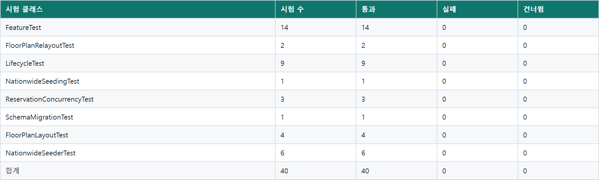

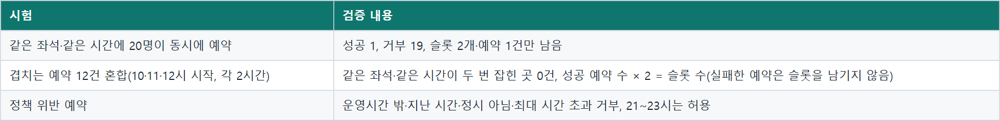

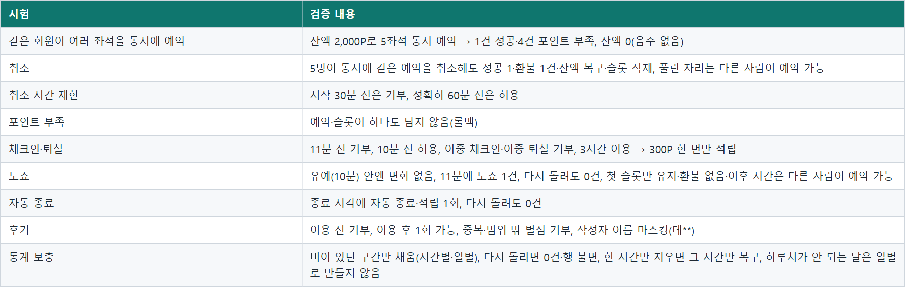

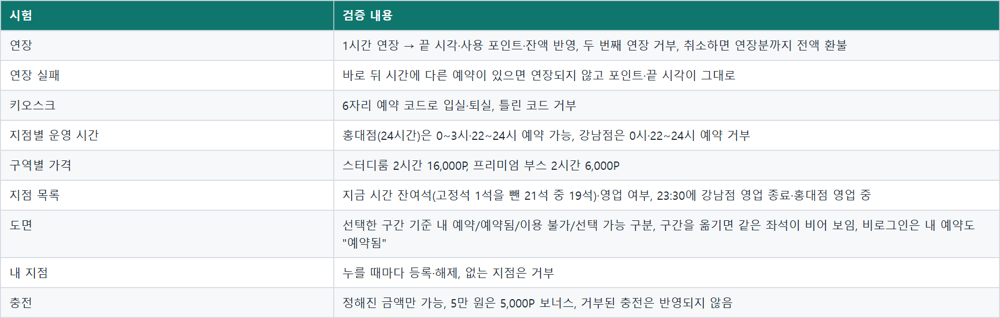

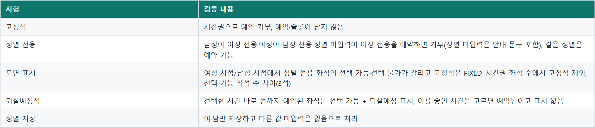

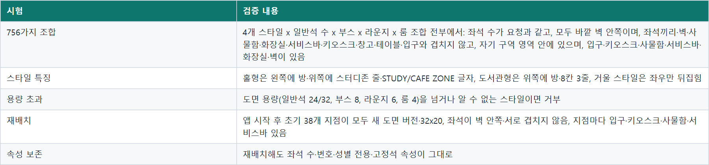

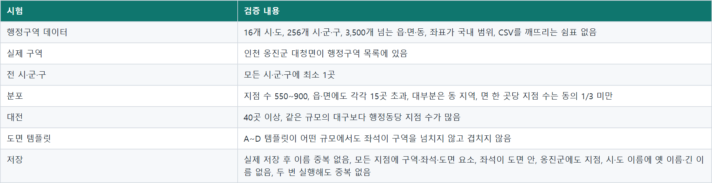

</details>

<details>
<summary><b>화면·HTTP 수동 확인</b></summary>

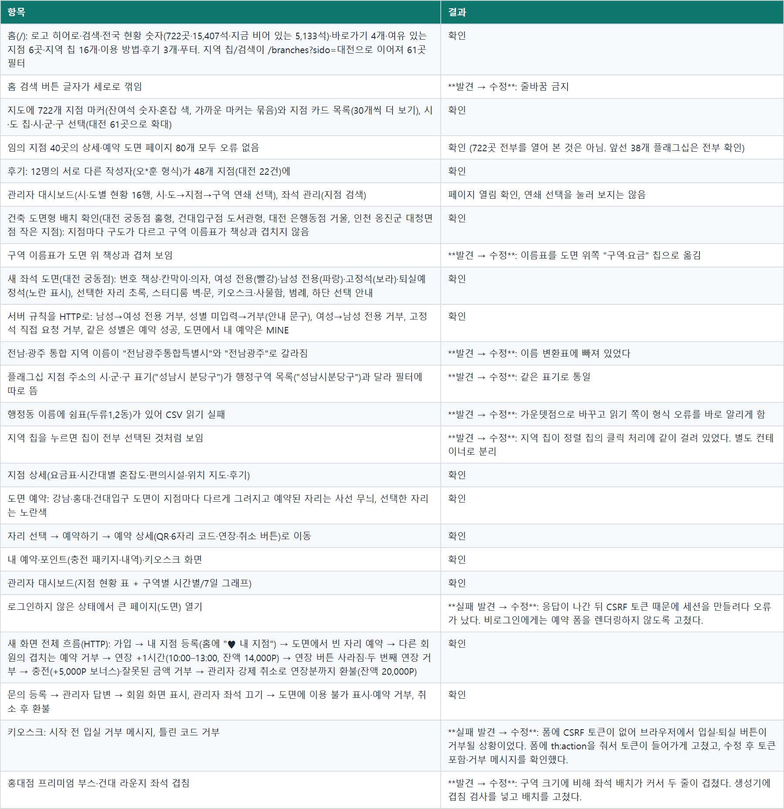

</details>

<details>
<summary><b>코드 리뷰 반영과 미확인</b></summary>

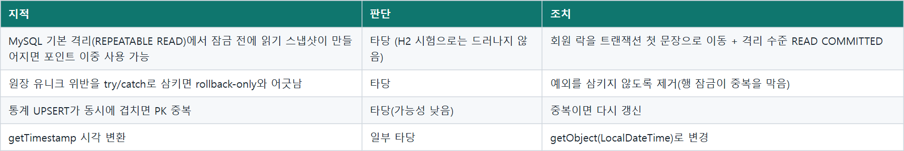

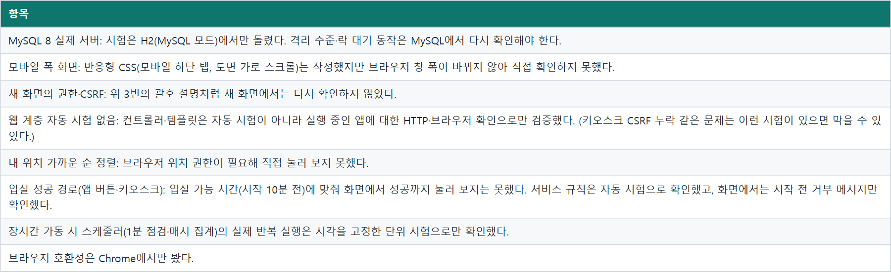

</details>

## 13. 트러블슈팅

실행해서 직접 눌러 보다가 찾은 것들입니다.

<details>
<summary><b>1. 키오스크 입실·퇴실 버튼이 거부될 뻔했습니다</b></summary>

1.1 문제 상황<br>
키오스크 폼에 CSRF 토큰이 없어서, 브라우저에서 입실·퇴실 버튼을 누르면 거부될 상황이었습니다.

1.2 원인<br>
폼의 `action`을 직접 적어서 Thymeleaf가 토큰을 넣어 주지 못했습니다.

1.3 해결<br>
`th:action`을 쓰게 고쳤고, 고친 뒤 토큰이 들어가는 것과 시작 전 입실이 거부되는 메시지를 확인했습니다.
</details>

<details>
<summary><b>2. 로그인하지 않고 도면 페이지를 열면 오류가 났습니다</b></summary>

2.1 문제 상황<br>
비로그인 상태에서 큰 페이지(도면)를 열면 응답 도중에 오류가 났습니다.

2.2 원인<br>
응답이 이미 나간 뒤에 CSRF 토큰 때문에 세션을 만들려다 실패했습니다.

2.3 해결<br>
로그인하지 않은 사용자에게는 예약 폼을 아예 렌더링하지 않도록 했습니다. 어차피 예약은 로그인 뒤에만 되기 때문입니다.
</details>

<details>
<summary><b>3. 지점마다 "일반석"이 있는데 구역 이름 유니크가 막았습니다</b></summary>

3.1 문제 상황<br>
지점을 여러 개 넣자 같은 이름의 구역("일반석")이 유니크 제약에 걸렸습니다.

3.2 원인<br>
처음에는 지점이 하나라서 구역 이름 전체에 유니크를 걸어 두었습니다.

3.3 해결<br>
유니크 범위를 지점 안(`branch_id`, `name`)으로 좁혔습니다.
</details>

<details>
<summary><b>4. planH, posX 같은 필드의 컬럼 매핑이 깨졌습니다</b></summary>

4.1 문제 상황<br>
서버가 시작될 때 컬럼을 찾지 못해 실패했습니다.

4.2 원인<br>
이름이 대문자 한 글자로 끝나는 필드는 Spring의 이름 변환이 밑줄을 넣어 주지 않아서 컬럼 이름이 달라졌습니다.

4.3 해결<br>
`@Column`으로 컬럼 이름을 직접 적었습니다.
</details>

<details>
<summary><b>5. 홍대점 부스와 건대 라운지에서 좌석이 겹쳤습니다</b></summary>

5.1 문제 상황<br>
도면에서 두 줄의 좌석이 서로 겹쳐 그려졌습니다.

5.2 원인<br>
구역 크기에 비해 좌석 배치가 컸습니다.

5.3 해결<br>
생성기에 겹침 검사를 넣고 배치를 고쳤습니다. 이 검사가 나중에 도면 엔진의 756가지 조합 시험으로 커졌습니다.
</details>

<details>
<summary><b>6. 도면 위 구역 이름표가 책상과 겹쳐 보였습니다</b></summary>

6.1 문제 상황<br>
새 도면에서 구역 이름표가 책상 위에 얹혀 보였습니다.

6.2 해결<br>
이름표를 도면 위쪽의 "구역·요금" 칩으로 옮겼습니다.
</details>

<details>
<summary><b>7. 전남·광주 통합 지역 이름이 둘로 갈라졌습니다</b></summary>

7.1 문제 상황<br>
필터에 "전남광주통합특별시"와 "전남광주"가 따로 나왔습니다.

7.2 원인<br>
이름 변환표에 빠져 있었습니다.

7.3 해결<br>
변환표를 보완했습니다. 비슷한 문제로 플래그십 지점 주소의 "성남시 분당구"가 행정구역 목록의 "성남시분당구"와 달라 필터에 따로 뜬 적도 있어서 표기를 통일했습니다.
</details>

<details>
<summary><b>8. 행정동 이름의 쉼표가 CSV 읽기를 깨뜨렸습니다</b></summary>

8.1 문제 상황<br>
"두류1,2동" 같은 이름 때문에 행정구역 CSV를 읽지 못했습니다.

8.2 해결<br>
이름의 쉼표를 가운뎃점으로 바꾸고, 읽는 쪽이 형식 오류를 바로 알려 주게 했습니다.
</details>

<details>
<summary><b>9. 지역 칩을 누르면 칩이 전부 선택된 것처럼 보였습니다</b></summary>

9.1 문제 상황<br>
지역 칩 하나를 눌렀는데 정렬 칩까지 전부 선택된 것처럼 보였습니다.

9.2 원인<br>
지역 칩이 정렬 칩의 클릭 처리에 같이 걸려 있었습니다.

9.3 해결<br>
지역 칩을 별도 컨테이너로 분리했습니다.
</details>

## 14. 향후 개선 계획

### 1. 결제 연동

- 현재: 충전 금액을 고르면 바로 포인트가 쌓이는 데모 결제입니다.
- 개선: 실제 PG를 붙이고 결제 승인·취소 결과를 웹훅으로 받아 포인트 원장과 대조합니다. 결제는 됐는데 포인트가 안 쌓이거나 그 반대인 경우를 찾아내는 정산 작업도 같이 만듭니다.

### 2. 좌석 상태 실시간 반영

- 현재: 도면의 좌석 상태는 화면을 열거나 새로고침할 때 읽어 옵니다. 그 사이에 다른 사람이 예약하면 눌러 본 뒤에야 거부됩니다.
- 개선: SSE나 WebSocket으로 좌석 상태 변경을 밀어 주어 도면이 바로 바뀌게 합니다. 동시 예약 방지는 지금처럼 DB 제약이 맡고, 실시간 반영은 사용자에게 보이는 부분만 개선합니다.

### 3. 입실 인증 고도화

- 현재: 키오스크 화면에서 예약 코드(QR·6자리)를 입력해 입실하는 시뮬레이터입니다.
- 개선: QR 리더 단말과 단말 인증을 붙이고, 입퇴실 기록을 단말별로 남깁니다. 코드 공유로 남의 예약에 입실하는 경우를 막기 위해 코드 유효 시간과 재사용 제한도 둡니다.

### 4. 알림

- 현재: 예약 시작, 퇴실 임박, 노쇼 처리 같은 상태 변화를 사용자에게 알려 주는 수단이 없습니다.
- 개선: 시작 전과 퇴실 10분 전, 노쇼 처리 시점에 이메일이나 알림톡을 보냅니다. 발송은 예약 처리와 분리된 비동기 작업으로 둬서, 알림이 실패해도 예약은 영향을 받지 않게 합니다.

### 5. 혼잡도 예측

- 현재: 지점별 혼잡도는 예약 기준으로 시간·일 단위로 집계해서 보여 줍니다.
- 개선: 쌓인 시간대별 이용 패턴으로 다음 시간대의 혼잡 정도를 예측하고, 한산한 지점과 시간대를 추천합니다. 입실 기록을 같이 반영하면 예약만 하고 오지 않은 자리를 걸러낼 수 있습니다.

### 6. 조회 성능

- 현재: 전국 지점 약 720곳의 지도 JSON과 통계를 요청마다 조회합니다.
- 개선: 지도 JSON과 통계에 캐시(Redis)를 두고, 지점 목록은 지역·이름 검색용 인덱스와 페이징을 추가합니다. 슬롯 테이블은 날짜 기준 파티셔닝을 검토합니다.

### 7. 회원·권한

- 현재: 데모 계정(일반 회원, 관리자) 두 개로 로그인합니다.
- 개선: 회원가입과 이메일 인증, 소셜 로그인을 붙이고, 관리자를 전체 관리자와 지점 점주로 나눠서 자기 지점만 관리하게 합니다.

### 8. 운영 환경

- 현재: H2(MySQL 모드)에서 개발하고 시험했습니다.
- 개선: MySQL 8에서 동시성 시험을 다시 돌려 락과 격리 수준이 같게 동작하는지 확인합니다. Docker Compose로 앱과 DB를 함께 띄우고, GitHub Actions에서 빌드와 시험이 자동으로 돌게 합니다.

## 15. 정리 자료

[PDF](deliverables/StudySeat_발표자료_디자인판.pdf) · [PPT](deliverables/StudySeat_발표자료_디자인판.pptx)

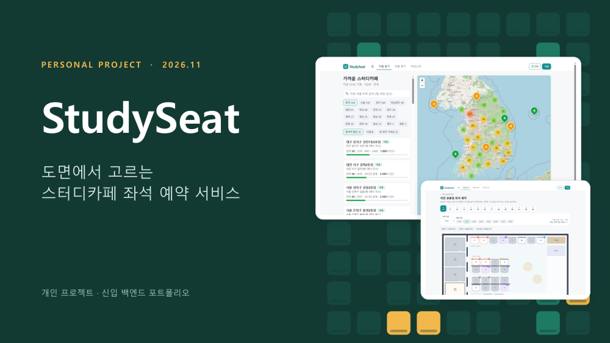 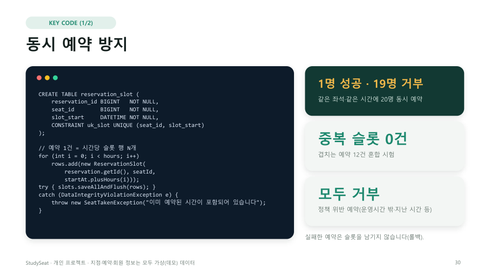 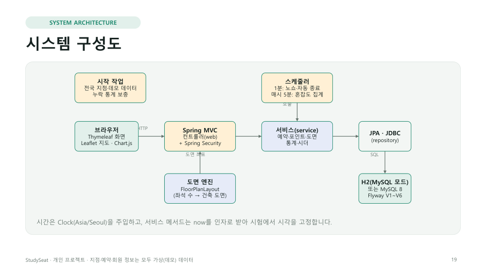 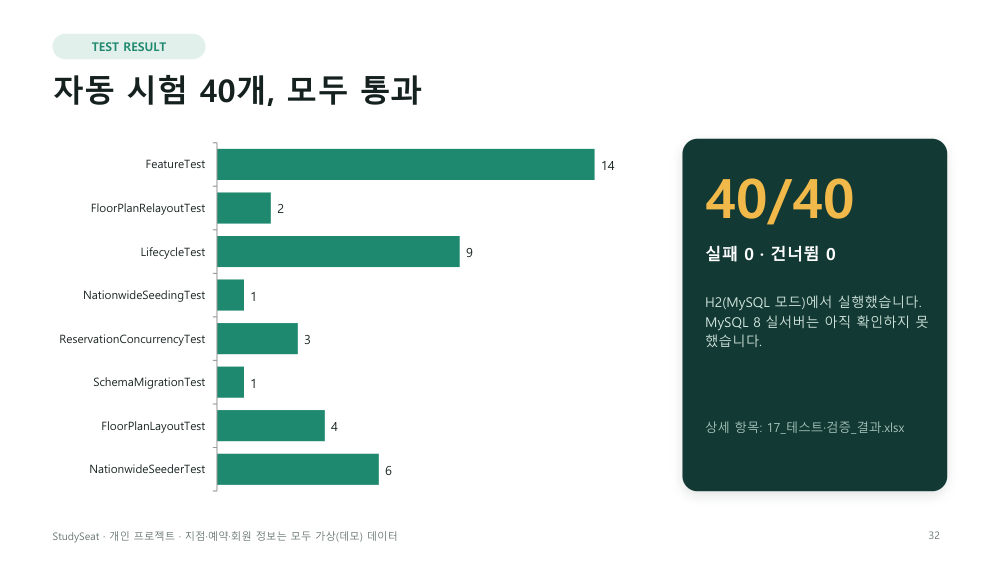
