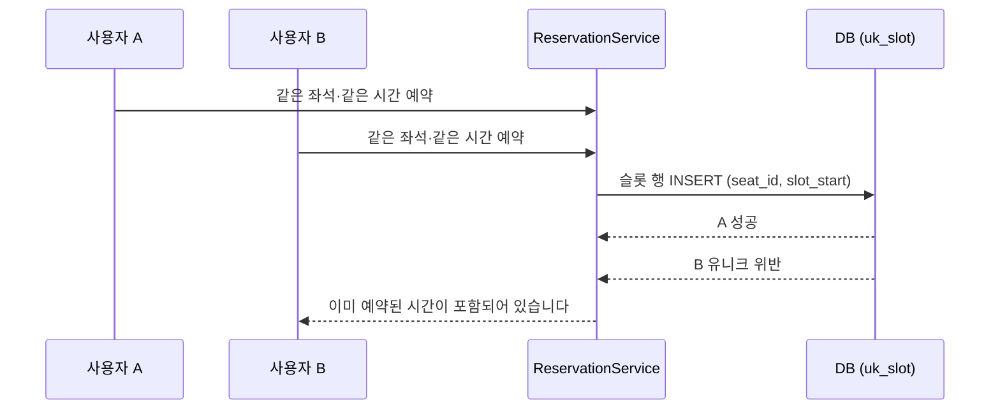
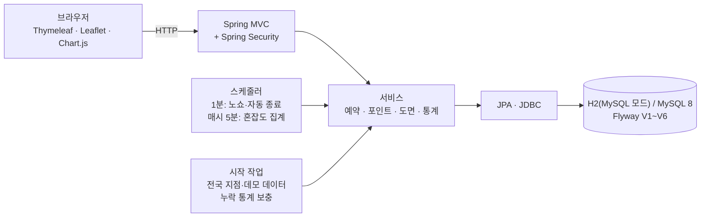

# StudySeat

스터디카페 좌석 예약 서비스입니다. 지점을 지도에서 찾고, 매장 도면에서 자리를 직접 눌러 예약하고, QR 코드로 입실합니다.


 

지점 이름, 주소, 전화번호, 예약, 회원, 후기는 전부 가짜 데이터입니다. 지점이 놓인 시·도·시·군·구·읍·면·동만 실제 행정구역입니다.

## 목차
1. [만든 이유](#1-만든-이유)
2. [프로젝트 목표](#2-프로젝트-목표)
3. [주요 기능](#3-주요-기능)
4. [서비스 화면](#4-서비스-화면)
5. [동시성과 포인트 처리](#5-동시성과-포인트-처리)
6. [도면 엔진과 혼잡도 통계](#6-도면-엔진과-혼잡도-통계)
7. [기술 스택](#7-기술-스택)
8. [시스템 아키텍처와 유스케이스](#8-시스템-아키텍처와-유스케이스)
9. [ERD와 테이블 명세서](#9-erd와-테이블-명세서)
10. [트러블슈팅](#10-트러블슈팅)
11. [테스트 결과](#11-테스트-결과)
12. [프로젝트 산출물](#12-프로젝트-산출물)
13. [향후 개선 계획](#13-향후-개선-계획)
14. [회고](#14-회고)
15. [실행 방법과 폴더 구조](#15-실행-방법과-폴더-구조)
16. [참고](#16-참고)

---

## 1. 만든 이유

두 사람이 같은 자리를 동시에 누르면 어떻게 될까요?

스터디카페 예약 서비스를 만들면서 가장 먼저 붙잡은 질문입니다. 같은 문제를 어떻게 막는지 말로만 설명하지 않고 시험으로 보여 주고 싶어서 이 프로젝트를 만들었습니다.

소재는 방탈출 카페 예약 서비스인 [OBM](https://github.com/chuyj15/OBM)(JSP/Servlet)에서 가져왔습니다. 시간대를 골라 예약하고, 포인트가 있고, 후기와 1:1 문의, 관리자 취소가 있는 흐름이 스터디카페 좌석 예약에도 그대로 쓸 만했습니다. 코드는 쓰지 않았고 Spring Boot로 처음부터 다시 설계했습니다.

처음 버전은 열람실 좌석 표 하나가 전부였는데, 보여 주고 나서 너무 대충 만들었다는 지적을 받았습니다. 그래서 렛미업, 1PP, 스터디봄 같은 실제 앱의 소개 문서를 찾아 읽고 지점과 지도, 도면 좌석 선택, QR 입실, 연장, 충전을 넣어서 다시 만들었습니다. 다음에는 지점이 서울에만 있다는 말을 들어서 전국 행정구역 기준으로 넓혔고, 마지막으로 화면이 AI가 만든 것 같다는 말을 듣고 글꼴과 아이콘을 바꾸고 그라데이션을 걷어냈습니다.

실제 스터디카페 앱에서 확인한 기능은 이렇게 옮겼습니다. 조사한 자료가 앱스토어 소개문과 고객센터 문서 수준이라, 화면 구성의 세부는 새로 설계했습니다.

| 실제 앱에서 본 기능 | StudySeat |
|---|---|
| 위치로 가까운 지점 찾기, 자주 가는 지점 등록 | 전국 지도와 시·도·시·군·구 선택, 검색, 잔여석·거리순 정렬, 내 지점 |
| 좌석·스터디룸 현황 실시간 확인 | 도면에 좌석 상태 표시, 지도 마커에 지금 남은 좌석 수 |
| 좌석 종류마다 다른 요금 | 구역별 시간당 요금 |
| 이용 시간 연장 | 이용 중 1~2시간 연장 |
| QR 코드 키오스크 입·퇴실 | QR과 6자리 코드, 키오스크 시뮬레이터 |
| 충전 포인트 | 포인트 충전(데모 결제)과 보너스, 원장 |
| 지점마다 다른 운영 시간 | 지점별 운영 시간(24시간 지점 포함) |

규모는 가상 지점 약 720곳(실제 시·군·구 256곳 위에 배치), 좌석 약 1만 5천 석입니다.

## 2. 프로젝트 목표

처음부터 시험으로 증명할 수 있는 것만 목표로 잡았습니다.

- 같은 좌석에 20명이 동시에 예약해도 1명만 성공하고, 같은 자리가 두 번 잡히는 일이 0건이어야 합니다.
- 같은 회원이 여러 좌석을 동시에 예약해도 포인트가 이중으로 빠지지 않아야 합니다. 환불과 적립도 두 번 기록되면 안 됩니다.
- 좌석 수만 주면 건축 도면처럼 배치하는 도면 엔진을 만들고, 어떤 조합에서도 좌석이 겹치지 않아야 합니다(756가지 조합).
- 지점마다 다른 운영 시간과 요금을 같은 코드로 처리하고, 서버가 꺼져 있던 시간의 혼잡도 통계도 다시 채워야 합니다.

## 3. 주요 기능

- 전국 지도에서 지점을 찾습니다. 시·도와 시·군·구로 좁히거나 이름으로 검색하고, 잔여석 순이나 거리순으로 정렬하고, 자주 가는 지점은 내 지점으로 등록합니다. 지도 마커에는 지금 남은 좌석 수가 보입니다.
- 지점마다 운영 시간과 구역별 시간당 요금이 다릅니다. 홍대점은 24시간 운영입니다.
- 날짜와 시간을 고른 뒤 도면에서 자리를 누르면 예약됩니다. 여성 전용, 남성 전용, 월 이용권 회원 전용(고정석), 바로 앞 시간까지 쓰다 비는 자리(퇴실예정석)가 도면에 따로 표시됩니다.
- 예약하면 QR과 6자리 코드가 나오고, 키오스크 시뮬레이터에서 코드로 입실과 퇴실을 합니다. 이용 중에는 1~2시간 연장할 수 있고(예약당 한 번), 시작 60분 전까지는 전액 환불로 취소됩니다. 입실하지 않으면 노쇼로 처리되고, 퇴실을 안 눌러도 종료 시각에 자동으로 끝납니다.
- 포인트 충전(결제는 데모), 이용 후 후기, 1:1 문의가 있습니다.
- 관리자는 지점 현황과 구역별 혼잡도 그래프를 보고, 좌석을 끄거나 예약을 강제로 취소하고 문의에 답합니다.

## 4. 서비스 화면

### 홈
검색창과 전국 지점 수, 지금 비어 있는 좌석 수, 지금 여유 있는 지점, 지역별 지점 수가 나옵니다. 지역 칩이나 검색어는 지점 찾기 지도로 이어집니다.


### 지점 찾기와 상세
지도 마커에 남은 좌석 수가 보이고, 가까운 마커끼리는 묶입니다. 지점 상세에서는 요금표, 구역별 지금 잔여, 시간대별 혼잡도(최근 2주 평균), 편의시설, 위치, 후기를 봅니다.

 

### 도면에서 좌석 선택
지점마다 도면의 구도가 다릅니다. 아래는 홀형(대전 궁동점), 도서관형(건대입구점), 작은 지점(인천 옹진군 대청면점)입니다.

  

### 예약 완료, 포인트, 키오스크
예약하면 QR과 6자리 코드가 나오고 연장과 취소 버튼이 이어집니다. 포인트는 충전 금액에 따라 보너스가 붙습니다.

  

### 관리자 대시보드
시·도별 현황과 구역별 시간별 막대, 7일 평균·최대 선이 나오고, 누락된 통계를 지금 채우는 버튼이 있습니다.


## 5. 동시성과 포인트 처리

### 동시에 같은 자리를 누르면

예약 한 건을 1시간짜리 슬롯 행으로 나눠 저장하고, `reservation_slot` 테이블에 `(seat_id, slot_start)` 유니크 제약을 걸었습니다. 겹치는 시간이 있는지를 코드로 검사하지 않고, 두 번째 INSERT가 제약에 걸려 실패하게 만든 것입니다. 동시에 들어온 요청도 DB가 한 건만 받아 줍니다.



```java
@Transactional
public Reservation reserve(Long memberId, Long seatId, LocalDateTime startAt, int hours, LocalDateTime now) {
    // 회원 락을 트랜잭션 첫 문장으로 잡는다 (MySQL 기본 격리에서 읽기 스냅샷이 먼저 만들어지는 문제 때문)
    Member member = members.findByIdForUpdate(memberId).orElseThrow(...);
    ...
    List<ReservationSlot> rows = new ArrayList<>();
    for (int i = 0; i < hours; i++) {
        rows.add(new ReservationSlot(reservation.getId(), seatId, startAt.plusHours(i)));
    }
    try {
        slots.saveAllAndFlush(rows);   // (seat_id, slot_start) 유니크 제약이 겹침을 거부
    } catch (DataIntegrityViolationException e) {
        throw new SeatTakenException("이미 예약된 시간이 포함되어 있습니다");
    }
    points.use(memberId, reservation.getId(), price, now);
    return reservation;
}
```

시험에서는 같은 좌석, 같은 시간에 20명이 동시에 예약하면 1명이 성공하고 19명이 거부됩니다. 시작 시각이 서로 다른 겹치는 예약 12건을 섞어 돌려도 같은 자리가 두 번 잡힌 경우는 0건이었습니다.

### 포인트는 원장으로

같은 회원이 여러 좌석을 동시에 예약하면 포인트가 이중으로 빠질 수 있습니다. 그래서 `reserve`의 첫 줄에서 회원 행을 비관적 락으로 잠그고, 격리 수준은 READ COMMITTED로 맞췄습니다. 잔액 2,000P로 5개 좌석을 동시에 예약하는 시험에서 1건만 성공하고 잔액은 0이 됩니다. 락을 일부러 일반 조회로 바꿔 보니 이 시험이 실패했고, 되돌리니 다시 통과했습니다. 시험이 정말 문제를 잡는지 확인하려고 한 일입니다.

잔액은 따로 저장하지 않고 `point_ledger`의 합계로 계산합니다. 원장에는 쌓기만 하고(충전, 사용, 연장, 환불, 적립), `(reservation_id, reason)`에 유니크를 걸어서 같은 예약에 환불이나 적립이 두 번 기록되지 않게 했습니다. 같은 예약을 5명이 동시에 취소해도 환불은 한 번만 들어갑니다. 연장은 `EXTEND`로 따로 기록하기 때문에, 연장한 뒤 취소하면 연장분까지 합쳐서 전액이 돌아옵니다.

## 6. 도면 엔진과 혼잡도 통계

### 도면 엔진

도면 화면은 실제 독서실·스터디카페 앱의 좌석 선택 화면(벽, 칸막이 책상, 2인실과 3인실, 키오스크, 사물함, 범례)을 참고했습니다. 처음에는 격자 템플릿으로 그렸는데 형태가 너무 밋밋해서, 좌석 수만 넘기면 도면을 만들어 주는 `FloorPlanLayout`으로 바꿨습니다. 바깥 벽과 문이 달린 스터디룸, 칸막이가 있는 책상 섬, 사물함, 서비스바, 키오스크, 입구, 카페 테이블을 놓고, 홀형과 도서관형에 각각 좌우를 뒤집은 것까지 4가지 스타일이 있어서 지점마다 구도가 다릅니다.

좌석이 많든 적든, 읍·면의 작은 지점이든 벽 안에서 겹치지 않아야 해서 756가지 조합을 시험으로 돌립니다. 좌석, 벽, 사물함, 화장실, 서비스바, 키오스크, 창고, 테이블, 입구가 서로 겹치는 조합은 없었습니다.

### 혼잡도 통계

예약 슬롯 수를 사용 가능한 좌석 수로 나눈 점유율을 구역별로 집계합니다. 매시 5분에 직전 시간을 계산하고, 그날 마지막 운영 시간이 끝나면 일별 평균, 최대, 피크 시각도 계산합니다.

서버가 꺼져 있던 시간은 통계가 비어 버리기 때문에, 시작할 때 최근 48시간(시간별)과 최근 7일(일별)을 훑어서 빈 구간만 채웁니다. 시간별 데이터가 하루치 다 있는 날만 일별로 만듭니다. 일부 시간만으로 평균을 내면 틀리기 때문입니다. 이미 있는 구간은 건드리지 않아서 다시 돌려도 변하지 않고, 한 시간만 지워 두면 그 시간만 복구됩니다.

## 7. 기술 스택

| 구분 | 사용한 것 |
|---|---|
| 백엔드 | Java 17, Spring Boot 4.1.2, Spring Data JPA, Spring Security(세션) |
| 화면 | Thymeleaf, Leaflet(OpenStreetMap), Chart.js, Pretendard, Lucide |
| 데이터 | H2(MySQL 모드), MySQL 8, Flyway |
| 시험·빌드 | JUnit 5, Gradle 9.8.1 |
| 개발 환경 | Windows 10, JDK 17(Docker와 MySQL은 설치되어 있지 않아 H2로 개발) |

## 8. 시스템 아키텍처와 유스케이스

### 유스케이스


### 시스템 아키텍처



패키지는 `config`(보안, 시계, 스케줄러, 시작 작업), `domain`(엔티티), `repository`, `service`(업무 규칙), `web`(컨트롤러, 도면 변환)으로 나눴습니다. 시간은 `Clock`(Asia/Seoul)을 주입하고 서비스 메서드가 `now`를 인자로 받게 해서, 시험에서 시각을 마음대로 고정할 수 있습니다. 스키마는 Flyway(V1~V6)가 만들고 JPA는 `ddl-auto: validate`로 맞는지만 봅니다. POST 요청은 전부 CSRF 토큰이 필요합니다.

<details>
<summary>스케줄과 시작 작업</summary>

| 작업 | 주기 | 내용 |
|---|---|---|
| 예약 점검 sweep | 1분 | 노쇼 처리, 이용 종료 시각이 지난 이용 자동 종료·적립 |
| 직전 시간 집계 | 매시 5분 | 방금 끝난 시간을 구역별로 집계(지점 운영 시간만), 그날 마지막 운영 시간이면 일별도 집계 |
| 시작 작업 | 앱 시작 시 1회 | (데모) 계정·전국 지점(실제 읍·면·동 위에 가상 지점) 생성·오늘 앞뒤 시간대 예약·지난 3일 통계 합성 → 누락 통계 보충(시간별 48시간 → 일별 7일) |

</details>

구성도 PDF는 [12_시스템·서비스_구성도.pdf](deliverables/12_시스템·서비스_구성도.pdf), 유스케이스는 [10_유스케이스_다이어그램.pdf](deliverables/10_유스케이스_다이어그램.pdf)입니다.

## 9. ERD와 테이블 명세서


<details>
<summary>ERD (mermaid, 테이블 14개)</summary>


</details>

테이블 14개와 컬럼 수는 다음과 같고, 컬럼 단위 명세와 제약·인덱스는 [14_데이터_테이블_명세서.xlsx](deliverables/14_데이터_테이블_명세서.xlsx)에 있습니다.

| 테이블 | 컬럼 수 |
|---|---|
| branch | 9 |
| zone | 9 |
| seat | 12 |
| plan_object | 4 |
| favorite_branch | 2 |
| member | 6 |
| reservation | 8 |
| reservation_slot | 4 |
| point_ledger | 5 |
| review | 5 |
| inquiry | 4 |
| occupancy_hourly | 4 |
| occupancy_daily | 5 |
| cafe_policy | 5 |

설계하면서 정한 것들은 이렇습니다.

- 예약 1건을 1시간 슬롯 행으로 쪼갬: 시간 구간 겹침 검사를 앱 코드가 아니라 (seat_id, slot_start) 유니크 제약이 맡아, 동시 요청도 DB가 한 건만 받아준다
- 지점마다 운영 시간(open_hour~close_hour): 24시간 지점(0~24)과 일반 지점을 같은 코드로 처리. 통계 집계·보충도 지점 운영 시간을 따른다
- 구역마다 시간당 가격: 일반석·프리미엄 부스·스터디룸 요금이 다르다. 예약 금액 = 구역 가격 × 시간
- 도면 좌표를 DB에 저장(격자 칸 단위): 화면은 좌표를 퍼센트로 바꿔 그리기만 한다. 지점마다 배치가 다르고, 좌석 상태만 서버가 계산해 색을 입힌다
- 성별 전용·고정석을 좌석 속성(gender, fixed_seat)으로 둠: 도면에서는 선택 못 하게 그리고, 예약 서비스(ReservationService.checkSeatAllowed)가 같은 규칙을 한 번 더 검사해 직접 요청도 막는다. 일반석 번호 규칙(8로 나눠 1·2=여성, 8의 배수=남성, 10으로 나눠 4=고정석)은 V5 SQL과 시더가 같다
- 취소 시 슬롯 삭제, 노쇼 시 첫 슬롯만 유지: 취소는 자리를 완전히 열고, 노쇼는 이미 시작한 첫 시간을 막은 채 이후 시간만 푼다(그 시간의 혼잡도 통계도 유지됨)
- 포인트 원장 + 잔액은 합계: 잔액 컬럼을 따로 고치지 않아 이력과 어긋날 수 없고, 환불·적립·연장 중복을 유니크 인덱스로 막는다
- 연장은 EXTEND로 따로 기록, 예약당 1회: (예약, 사유) 유니크를 그대로 활용. 취소 환불은 예약의 총 사용액(used_point) 기준
- 회원 행·예약 행에 비관적 락: 같은 회원의 동시 예약(포인트 이중 사용), 같은 예약의 동시 취소/체크인/연장을 한 줄로 세운다
- 통계는 PK 기준 갱신 후 없으면 삽입: 같은 구간을 다시 계산해도 행이 늘지 않는다(멱등)
- 시간별 → 일별 순서로 보충, 일별은 하루치 시간별이 다 있을 때만: 일부 시간만으로 평균을 내면 부정확하기 때문

## 10. 트러블슈팅

실행해서 직접 눌러 보다가 찾은 것들입니다.

<details>
<summary>키오스크 입실·퇴실 버튼이 거부될 뻔했습니다</summary>

문제: 키오스크 폼에 CSRF 토큰이 없어서, 브라우저에서 입실·퇴실 버튼을 누르면 거부될 상황이었습니다.
원인: 폼의 `action`을 직접 적어서 Thymeleaf가 토큰을 넣어 주지 못했습니다.
해결: `th:action`을 쓰게 고쳤고, 고친 뒤 토큰이 들어가는 것과 시작 전 입실이 거부되는 메시지를 확인했습니다.
</details>

<details>
<summary>로그인하지 않고 도면 페이지를 열면 오류가 났습니다</summary>

문제: 비로그인 상태에서 큰 페이지(도면)를 열면 응답 도중에 오류가 났습니다.
원인: 응답이 이미 나간 뒤에 CSRF 토큰 때문에 세션을 만들려다 실패했습니다.
해결: 로그인하지 않은 사용자에게는 예약 폼을 아예 렌더링하지 않도록 했습니다. 어차피 예약은 로그인 뒤에만 되기 때문입니다.
</details>

<details>
<summary>지점마다 "일반석"이 있는데 구역 이름 유니크가 막았습니다</summary>

문제: 지점을 여러 개 넣자 같은 이름의 구역("일반석")이 유니크 제약에 걸렸습니다.
원인: 처음에는 지점이 하나라서 구역 이름 전체에 유니크를 걸어 두었습니다.
해결: 유니크 범위를 지점 안(`branch_id`, `name`)으로 좁혔습니다.
</details>

<details>
<summary>planH, posX 같은 필드의 컬럼 매핑이 깨졌습니다</summary>

문제: 서버가 시작될 때 컬럼을 찾지 못해 실패했습니다.
원인: 이름이 대문자 한 글자로 끝나는 필드는 Spring의 이름 변환이 밑줄을 넣어 주지 않아서 컬럼 이름이 달라졌습니다.
해결: `@Column`으로 컬럼 이름을 직접 적었습니다.
</details>

<details>
<summary>홍대점 부스와 건대 라운지에서 좌석이 겹쳤습니다</summary>

문제: 도면에서 두 줄의 좌석이 서로 겹쳐 그려졌습니다.
원인: 구역 크기에 비해 좌석 배치가 컸습니다.
해결: 생성기에 겹침 검사를 넣고 배치를 고쳤습니다. 이 검사가 나중에 도면 엔진의 756가지 조합 시험으로 커졌습니다.
</details>

<details>
<summary>도면 위 구역 이름표가 책상과 겹쳐 보였습니다</summary>

문제: 새 도면에서 구역 이름표가 책상 위에 얹혀 보였습니다.
해결: 이름표를 도면 위쪽의 "구역·요금" 칩으로 옮겼습니다.
</details>

<details>
<summary>전남·광주 통합 지역 이름이 둘로 갈라졌습니다</summary>

문제: 필터에 "전남광주통합특별시"와 "전남광주"가 따로 나왔습니다.
원인: 이름 변환표에 빠져 있었습니다.
해결: 변환표를 보완했습니다. 비슷한 문제로 플래그십 지점 주소의 "성남시 분당구"가 행정구역 목록의 "성남시분당구"와 달라 필터에 따로 뜬 적도 있어서 표기를 통일했습니다.
</details>

<details>
<summary>행정동 이름의 쉼표가 CSV 읽기를 깨뜨렸습니다</summary>

문제: "두류1,2동" 같은 이름 때문에 행정구역 CSV를 읽지 못했습니다.
해결: 이름의 쉼표를 가운뎃점으로 바꾸고, 읽는 쪽이 형식 오류를 바로 알려 주게 했습니다.
</details>

<details>
<summary>지역 칩을 누르면 칩이 전부 선택된 것처럼 보였습니다</summary>

문제: 지역 칩 하나를 눌렀는데 정렬 칩까지 전부 선택된 것처럼 보였습니다.
원인: 지역 칩이 정렬 칩의 클릭 처리에 같이 걸려 있었습니다.
해결: 지역 칩을 별도 컨테이너로 분리했습니다.
</details>

## 11. 테스트 결과

`./gradlew test`로 40개를 돌리고, 지금은 전부 통과합니다(H2, MySQL 모드).

| 시험 클래스 | 개수 | 무엇을 보나 |
|---|---|---|
| ReservationConcurrencyTest | 3 | 20명 동시 예약, 겹치는 예약 12건 혼합, 정책 위반 거부 |
| LifecycleTest | 9 | 포인트 동시 사용, 동시 취소, 체크인·노쇼·자동 종료, 후기, 통계 보충 |
| FeatureTest | 14 | 연장, 키오스크, 지점별 운영 시간, 구역별 가격, 도면 상태, 내 지점, 충전, 좌석 규칙 |
| FloorPlanLayoutTest, FloorPlanRelayoutTest | 4, 2 | 756가지 조합에서 도면이 겹치지 않는지, 앱 시작 때 기존 지점 재배치 |
| NationwideSeederTest, NationwideSeedingTest | 6, 1 | 전국 지점 분포 규칙, 저장 결과 |
| SchemaMigrationTest | 1 | Flyway 적용 후 테이블·지점 |

컨트롤러와 템플릿에는 자동 시험이 없습니다. 그쪽은 실행 중인 앱을 직접 눌러 보며 확인했습니다.

<details>
<summary>실행 중인 앱에서 직접 확인한 항목 (24개)</summary>

| 항목 | 결과 |
|---|---|
| 홈(/): 로고 히어로·검색·전국 현황 숫자(722곳·15,407석·지금 비어 있는 5,133석)·바로가기 4개·여유 있는 지점 6곳·지역 칩 16개·이용 방법·후기 3개·푸터. 지역 칩/검색이 /branches?sido=대전으로 이어져 61곳 필터 | 확인 |
| 홈 검색 버튼 글자가 세로로 꺾임 | 발견 → 수정: 줄바꿈 금지 |
| 지도에 722개 지점 마커(잔여석 숫자·혼잡 색, 가까운 마커는 묶음)와 지점 카드 목록(30개씩 더 보기), 시·도 칩·시·군·구 선택(대전 61곳으로 확대) | 확인 |
| 임의 지점 40곳의 상세·예약 도면 페이지 80개 모두 오류 없음 | 확인 (722곳 전부를 열어 본 것은 아님. 앞선 38개 플래그십은 전부 확인) |
| 후기: 12명의 서로 다른 작성자(오*훈 형식)가 48개 지점(대전 22건)에 | 확인 |
| 관리자 대시보드(시·도별 현황 16행, 시·도→지점→구역 연쇄 선택), 좌석 관리(지점 검색) | 페이지 열림 확인, 연쇄 선택을 눌러 보지는 않음 |
| 건축 도면형 배치 확인(대전 궁동점 홀형, 건대입구점 도서관형, 대전 은행동점 거울, 인천 옹진군 대청면점 작은 지점): 지점마다 구도가 다르고 구역 이름표가 책상과 겹치지 않음 | 확인 |
| 구역 이름표가 도면 위 책상과 겹쳐 보임 | 발견 → 수정: 이름표를 도면 위쪽 "구역·요금" 칩으로 옮김 |
| 새 좌석 도면(대전 궁동점): 번호 책상·칸막이·의자, 여성 전용(빨강)·남성 전용(파랑)·고정석(보라)·퇴실예정석(노란 표시), 선택한 자리 초록, 스터디룸 벽·문, 키오스크·사물함, 범례, 하단 선택 안내 | 확인 |
| 서버 규칙을 HTTP로: 남성→여성 전용 거부, 성별 미입력→거부(안내 문구), 여성→남성 전용 거부, 고정석 직접 요청 거부, 같은 성별은 예약 성공, 도면에서 내 예약은 MINE | 확인 |
| 전남·광주 통합 지역 이름이 "전남광주통합특별시"와 "전남광주"로 갈라짐 | 발견 → 수정: 이름 변환표에 빠져 있었다 |
| 플래그십 지점 주소의 시·군·구 표기("성남시 분당구")가 행정구역 목록("성남시분당구")과 달라 필터에 따로 뜸 | 발견 → 수정: 같은 표기로 통일 |
| 행정동 이름에 쉼표(두류1,2동)가 있어 CSV 읽기 실패 | 발견 → 수정: 가운뎃점으로 바꾸고 읽기 쪽이 형식 오류를 바로 알리게 함 |
| 지역 칩을 누르면 칩이 전부 선택된 것처럼 보임 | 발견 → 수정: 지역 칩이 정렬 칩의 클릭 처리에 같이 걸려 있었다. 별도 컨테이너로 분리 |
| 지점 상세(요금표·시간대별 혼잡도·편의시설·위치 지도·후기) | 확인 |
| 도면 예약: 강남·홍대·건대입구 도면이 지점마다 다르게 그려지고 예약된 자리는 사선 무늬, 선택한 자리는 노란색 | 확인 |
| 자리 선택 → 예약하기 → 예약 상세(QR·6자리 코드·연장·취소 버튼)로 이동 | 확인 |
| 내 예약·포인트(충전 패키지·내역)·키오스크 화면 | 확인 |
| 관리자 대시보드(지점 현황 표 + 구역별 시간별/7일 그래프) | 확인 |
| 로그인하지 않은 상태에서 큰 페이지(도면) 열기 | 실패 발견 → 수정: 응답이 나간 뒤 CSRF 토큰 때문에 세션을 만들려다 오류가 났다. 비로그인에게는 예약 폼을 렌더링하지 않도록 고쳤다. |
| 새 화면 전체 흐름(HTTP): 가입 → 내 지점 등록(홈에 "♥ 내 지점") → 도면에서 빈 자리 예약 → 다른 회원의 겹치는 예약 거부 → 연장 +1시간(10:00–13:00, 잔액 14,000P) → 연장 버튼 사라짐·두 번째 연장 거부 → 충전(+5,000P 보너스)·잘못된 금액 거부 → 관리자 강제 취소로 연장분까지 환불(잔액 20,000P) | 확인 |
| 문의 등록 → 관리자 답변 → 회원 화면 표시, 관리자 좌석 끄기 → 도면에 이용 불가 표시·예약 거부, 취소 후 환불 | 확인 |
| 키오스크: 시작 전 입실 거부 메시지, 틀린 코드 거부 | 실패 발견 → 수정: 폼에 CSRF 토큰이 없어 브라우저에서 입실·퇴실 버튼이 거부될 상황이었다. 폼에 th:action을 줘서 토큰이 들어가게 고쳤고, 수정 후 토큰 포함·거부 메시지를 확인했다. |
| 홍대점 프리미엄 부스·건대 라운지 좌석 겹침 | 발견 → 수정: 구역 크기에 비해 좌석 배치가 커서 두 줄이 겹쳤다. 생성기에 겹침 검사를 넣고 배치를 고쳤다. |

</details>

시험 항목별 설명은 [17_테스트·검증_결과.xlsx](deliverables/17_테스트·검증_결과.xlsx)에, 원문은 [docs/03_테스트_결과.md](docs/03_테스트_결과.md)에 있습니다.

## 12. 프로젝트 산출물

프로젝트를 진행하면서 만든 문서와 표를 여기에 모았습니다. 원본 파일은 [deliverables](deliverables/) 폴더에 번호를 붙여 두었고(PDF와 엑셀), 이 README의 표와 그림은 그 내용을 옮긴 것입니다.

### WBS

작업을 크게 나눠서 정리한 표입니다.

| 단계 | 작업 | 상태 |
|---|---|---|
| 기획 | 참고 서비스(OBM) 분석, 범위·일정, 요구사항·ERD·API 초안, Gemini 설계 리뷰 반영 | 완료 |
| 기본 예약 | 좌석 예약 + 동시 예약 방지, 포인트 원장, 취소·환불, 체크인·퇴실, 노쇼·자동 종료, 후기·문의, 혼잡도 통계, 관리자 화면(시험 13개) | 완료 |
| 서비스 확장 | 지점·구역 가격·도면 좌표·내 지점·예약 코드, 연장, 키오스크, 충전, 지도·지점 상세 화면(시험 22개) | 완료 |
| 전국 지점 | 실제 행정구역(256개 시·군·구) 기준 지점 약 720곳, 지도 JSON API, 대용량 시드(JDBC 배치) | 완료 |
| 도면 | 도면 엔진(FloorPlanLayout), 성별 전용·고정석·퇴실예정석, 재배치(V5·V6), 시험 40개 | 완료 |
| 홈·디자인 | 홈 화면 분리, 디자인 패치(Pretendard·Lucide), 로고 | 완료 |
| 산출물 | 문서·엑셀·PPT·스크린샷 정리(이 문서 세트) | 완료 |
| 업로드 | GitHub에 날짜별로 나누어 업로드(실제 날짜로 커밋) | 예정 |
| 후속 | MySQL 8 실서버 검증, Docker Compose, GitHub Actions, 웹 계층 시험, 시연 영상 | 예정 |

### 요구사항 명세서

요구사항은 38개이고, 항목마다 어디까지 확인했는지 적어 두었습니다. 구현만 한 것, 자동 시험으로 확인한 것, 실행 중인 화면에서 직접 확인한 것을 구분했습니다.

| 구분 | 개수 | 예시 | 확인 |
|---|---|---|---|
| 지점·지도 | 5 | 지도에 지점을 마커로 보여주고, 마커·카드에 지금 잔여석과 혼잡 단계(여유/보통/혼잡/영업 종료)를 표시한다 | 3개는 자동 시험으로도 확인 |
| 계정 | 4 | 아이디(영문·숫자·밑줄 4~20자)·비밀번호(8자 이상)로 가입하고 환영 포인트를 지급한다 | 1개는 자동 시험으로도 확인 |
| 좌석·도면 | 6 | 지점 도면에 좌석·스터디룸·입구·카운터를 그리고, 선택한 날짜·시간 구간의 좌석 상태(선택 가능/예약됨/내 … | 4개는 자동 시험으로도 확인 |
| 예약 | 7 | 날짜·시작·이용 시간을 고르고 도면에서 좌석을 눌러 예약한다(정시, 지점 운영 시간 안, 1~8시간, 지난 … | 7개는 자동 시험으로도 확인 |
| 입퇴실·노쇼 | 3 | 예약 완료 시 6자리 코드와 QR을 보여주고, 앱 또는 키오스크(코드 입력)로 입실·퇴실한다 | 3개는 자동 시험으로도 확인 |
| 포인트 | 3 | 잔액은 원장 합계이며, 원장은 쌓기만 한다(충전·보너스·사용·연장·환불·적립) | 2개는 자동 시험으로도 확인 |
| 후기 | 2 | 이용을 마친(DONE) 예약에만 별점(1~5)·후기(500자 이내)를 1회 쓸 수 있다 | 2개는 자동 시험으로도 확인 |
| 문의 | 1 | 회원이 1:1 문의를 등록하고 관리자가 답변하며 회원이 답변을 본다 | 0개는 자동 시험으로도 확인 |
| 혼잡도 통계 | 3 | 구역별 시간별 점유율(예약 슬롯 수 / 사용 가능 좌석 수)을 매시 5분에 직전 시간 기준으로 집계한다(지점… | 1개는 자동 시험으로도 확인 |
| 관리자 | 4 | 지점 실시간 현황, 구역별 시간별 막대·7일 평균/최대 선, 누락 통계 수동 보충 | 1개는 자동 시험으로도 확인 |

<details>
<summary>요구사항 전체 보기 (38개)</summary>

| ID | 구분 | 요구사항 | 상태 |
|---|---|---|---|
| BR-001 | 지점 | 지도에 지점을 마커로 보여주고, 마커·카드에 지금 잔여석과 혼잡 단계(여유/보통/혼잡/영업 종료)를 표시한다 | 구현 · 시험 · 화면 확인 |
| BR-002 | 지점 | 지점 목록은 이름·주소로 검색하고, 잔여석 많은 순·내 위치 가까운 순으로 정렬한다 | 구현 · 화면 확인(거리순은 위치 권한 필요, 직접 눌러 보지는 못함) |
| BR-003 | 지점 | 지점 상세에서 요금표, 구역별 지금 잔여, 시간대별 혼잡도(최근 2주 평균), 편의시설, 위치, 후기를 보여준다 | 구현 · 화면 확인 |
| BR-004 | 지점 | 로그인한 회원이 지점을 "내 지점"으로 등록/해제한다 | 구현 · 시험 |
| BR-005 | 지점 | 지점마다 운영 시간이 다르다(24시간 지점 포함) | 구현 · 시험 |
| ACC-001 | 계정 | 아이디(영문·숫자·밑줄 4~20자)·비밀번호(8자 이상)로 가입하고 환영 포인트를 지급한다 | 구현 · 화면 확인 |
| ACC-002 | 계정 | 로그인(세션, BCrypt 해시). 로그인이 필요한 화면은 로그인으로 이동한다 | 구현 · 화면 확인 |
| ACC-003 | 계정 | 관리자(ADMIN)만 /admin/**에 접근한다 | 구현 · 화면 확인 (일반 회원 403) |
| SEAT-001 | 좌석 | 지점 도면에 좌석·스터디룸·입구·카운터를 그리고, 선택한 날짜·시간 구간의 좌석 상태(선택 가능/예약됨/내 예약/이용 불가)를 색으로 구분한다 | 구현 · 시험 · 화면 확인 |
| SEAT-002 | 좌석 | 비회원도 도면 현황을 볼 수 있고, 예약은 로그인 후 가능하다 | 구현 · 화면 확인 |
| SEAT-003 | 좌석 | 일반석 일부는 여성 전용·남성 전용이다(도면에 빨강·파랑 테두리와 "여/남" 뱃지). 회원 정보의 성별이 같을 때만 예약되고, 성별 미입력·불일치는 도면에서 선택 불가이며 서버도 거부한다 | 구현 · 시험 · 화면 확인 |
| SEAT-004 | 좌석 | 고정석(월 이용권 회원 전용, 보라색)은 시간권으로 예약할 수 없고 시간권 좌석 수(잔여/전체)에서 뺀다 | 구현 · 시험 · 화면 확인 |
| SEAT-005 | 좌석 | 선택한 시간 바로 전까지 다른 사람이 쓰다가 그 시간에 비는 자리를 "퇴실예정석"(노란 표시)으로 보여준다 | 구현 · 시험 · 화면 확인 |
| SEAT-006 | 좌석 | 도면은 도면 엔진이 좌석 수에 맞춰 건축 도면처럼 배치한다(바깥 벽, 문이 달린 방, 스터디존·카페존의 칸막이 책상 섬, 사물함 줄, 서비스바, 키오스크, 입구, 카페 테이블, 홀형·도서관형·좌우 거울 4스타일). 책상은 칸막이·의자가 있고, 구역·요금은 도면 위 칩으로 보여주며, 입구·키오스크·사물함·카운터·화장실·창가를 그리고 범례(선택가능·선택불가·내 예약·선택한 자리·퇴실예정·고정·여성/남성 전용)를 보여준다 | 구현 · 화면 확인 |
| ACC-004 | 계정 | 가입할 때 성별(여/남/선택 안 함)을 선택할 수 있다. 여/남 외의 값은 입력 안 함으로 본다 | 구현 · 시험 · 화면 확인 |
| RSV-001 | 예약 | 날짜·시작·이용 시간을 고르고 도면에서 좌석을 눌러 예약한다(정시, 지점 운영 시간 안, 1~8시간, 지난 시간 불가) | 구현 · 시험 · 화면 확인 |
| RSV-002 | 예약 | 같은 좌석의 겹치는 시간은 동시에 요청해도 한 건만 성공한다 | 구현 · 시험 |
| RSV-003 | 예약 | 예약 금액은 구역 시간당 가격 × 시간이며, 잔액이 모자라면 예약하지 않는다 | 구현 · 시험 |
| RSV-004 | 예약 | 같은 회원의 동시 예약이 포인트를 이중으로 쓰지 못한다 | 구현 · 시험 |
| RSV-005 | 예약 | 시작 60분 전까지 취소할 수 있고, 자리가 다시 열리며 포인트를 환불한다 | 구현 · 시험 |
| RSV-006 | 예약 | 같은 예약을 동시에 여러 번 취소해도 환불은 한 번이다 | 구현 · 시험 |
| RSV-007 | 예약 | 이용 시간을 1~2시간 연장한다(예약당 1회, 바로 뒤 시간이 차 있으면 실패하고 포인트도 그대로). 취소하면 연장분까지 환불한다 | 구현 · 시험 |
| USE-001 | 이용 | 예약 완료 시 6자리 코드와 QR을 보여주고, 앱 또는 키오스크(코드 입력)로 입실·퇴실한다 | 구현 · 시험 · 화면 확인 |
| USE-002 | 이용 | 체크인하지 않으면 노쇼 처리: 첫 1시간 슬롯은 유지하고 이후 슬롯은 풀며, 포인트는 환불하지 않는다 | 구현 · 시험 |
| USE-003 | 이용 | 퇴실을 누르지 않아도 종료 시각에 자동 종료하고 적립한다(한 번만) | 구현 · 시험 |
| PNT-001 | 포인트 | 잔액은 원장 합계이며, 원장은 쌓기만 한다(충전·보너스·사용·연장·환불·적립) | 구현 · 화면 확인 |
| PNT-002 | 포인트 | 같은 예약에 같은 사유(환불·적립·연장)는 두 번 기록되지 않는다 | 구현 · 시험 |
| PNT-003 | 포인트 | 정해진 금액만 충전할 수 있고 큰 금액은 보너스가 붙는다(데모 결제) | 구현 · 시험 |
| REV-001 | 후기 | 이용을 마친(DONE) 예약에만 별점(1~5)·후기(500자 이내)를 1회 쓸 수 있다 | 구현 · 시험 |
| REV-002 | 후기 | 후기 목록은 누구나 보며 작성자 이름은 가리고 지점을 함께 보여준다 | 구현 · 시험 |
| INQ-001 | 문의 | 회원이 1:1 문의를 등록하고 관리자가 답변하며 회원이 답변을 본다 | 구현 (이전 화면 버전에서 HTTP 흐름 확인) |
| STAT-001 | 통계 | 구역별 시간별 점유율(예약 슬롯 수 / 사용 가능 좌석 수)을 매시 5분에 직전 시간 기준으로 집계한다(지점 운영 시간만) | 구현 |
| STAT-002 | 통계 | 그날 마지막 운영 시간이 끝나면 일별 평균·최대·피크 시각을 집계한다 | 구현 |
| STAT-003 | 통계 | 앱이 꺼져 있던 구간을 시작 시 보충한다(시간별 최근 48시간 → 일별 최근 7일, 빈 구간만, 시간별이 하루치 다 있는 날만 일별로) | 구현 · 시험 |
| ADM-001 | 관리 | 지점 실시간 현황, 구역별 시간별 막대·7일 평균/최대 선, 누락 통계 수동 보충 | 구현 · 화면 확인 |
| ADM-002 | 관리 | 좌석 켜기/끄기(끄면 새 예약 불가·도면에 이용 불가 표시) | 구현 · 시험 |
| ADM-003 | 관리 | 예약 강제 취소(환불 포함) | 구현 (이전 화면 버전에서 HTTP 확인) |
| ADM-004 | 관리 | 문의 답변 | 구현 (이전 화면 버전에서 HTTP 확인) |

</details>

엑셀 원본은 [08_요구사항_명세서.xlsx](deliverables/08_요구사항_명세서.xlsx), 기능 목록과 사용자별 권한은 [09_기능_명세서_목록.xlsx](deliverables/09_기능_명세서_목록.xlsx)입니다.

### API 명세서

화면은 Thymeleaf로 그리기 때문에 대부분 HTML을 돌려주는 경로입니다. POST 요청은 전부 CSRF 토큰이 필요하고, 규칙을 어긴 요청(겹침, 포인트 부족, 시간 초과 등)은 예외를 잡아 화면 위에 메시지로 보여 줍니다.

<details>
<summary>화면(HTML) 경로 (18개)</summary>

| 메서드 | 경로 | 권한 | 설명 |
|---|---|---|---|
| `GET` | `/` | 모두 | 홈: 로고·검색·전국 현황·바로가기·내 지점·지금 여유 있는 지점·지역 칩·이용 방법·후기 |
| `GET` | `/branches` | 모두 | 지점 찾기: 지도 + 지점 카드(시·도 칩·시·군·구·검색·잔여석순·거리순). ?sido=대전&q=둔산으로 미리 필터 |
| `GET` | `/branches/{id}` | 모두 | 지점 상세: 요금표, 지금 잔여, 시간대별 혼잡도, 편의시설, 위치, 후기 |
| `POST` | `/branches/{id}/favorite` | 회원 | 내 지점 등록/해제 |
| `GET` | `/branches/{id}/book?date&start&hours` | 모두 | 날짜·시간을 고르고 도면에서 좌석 선택 |
| `POST` | `/reserve` | 회원 | 예약 seatId, branchId, date, start, hours → 예약 상세로 이동 |
| `GET` | `/reservations/{id}` | 본인 | 예약 상세: QR·코드, 남은 시간, 입실·퇴실·연장·취소 |
| `POST` | `/reservations/{id}/checkin · /checkout · /extend · /cancel` | 본인 | 입실 / 퇴실 / 연장(hours=1~2) / 취소 |
| `GET` | `/my/reservations` | 회원 | 이용 중·예정·지난 이용 |
| `GET` | `/my/points · POST /my/points/charge` | 회원 | 잔액·내역 / 충전(amount=10000·30000·50000·100000, 데모) |
| `GET·POST` | `/reviews` | GET 모두 / POST 회원 | 후기 목록 / 작성 reservationId, rating, content |
| `GET·POST` | `/my/inquiries` | 회원 | 1:1 문의 |
| `GET·POST` | `/signup · /login · POST /logout` | 모두 | 가입 / 로그인 / 로그아웃 |
| `GET·POST` | `/kiosk · /kiosk/checkin · /kiosk/checkout` | 모두(데모) | 키오스크 시뮬레이터: 예약 코드로 입·퇴실 |
| `GET` | `/admin · POST /admin/backfill` | 관리자 | 지점 실시간 현황 + 구역별 혼잡도 대시보드 / 누락 통계 수동 보충 |
| `GET` | `/admin/seats · POST /admin/seats/{id}/toggle` | 관리자 | 좌석 켜기/끄기 |
| `GET` | `/admin/reservations · POST /admin/reservations/{id}/cancel` | 관리자 | 최근 예약 100건 / 강제 취소(환불) |
| `GET` | `/admin/inquiries · POST /admin/inquiries/{id}/answer` | 관리자 | 문의 목록 / 답변 |

</details>

<details>
<summary>JSON 경로 (4개, 읽기 전용·로그인 불필요)</summary>

| 경로 | 응답 |
|---|---|
| `GET /api/branches` | [{id, name, address, lat, lng, openNow, freeSeats, totalSeats, level(OK/BUSY/FULL/CLOSED), minPricePerHour}] |
| `GET /api/stats/hourly?zoneId&date` | [{hour, occupied, capacity, rate}] |
| `GET /api/stats/daily?zoneId&days` | [{date, avgRate, peakRate, peakHour}] (어제까지 최근 N일, 1~31) |
| `GET /actuator/health` | 상태 확인 |

</details>

엑셀 원본은 [15_API_명세서.xlsx](deliverables/15_API_명세서.xlsx)입니다.

### 정리 자료(PDF·PPT)

정리해서 발표용으로 만든 자료도 [PDF](deliverables/StudySeat_발표자료_디자인판.pdf)와 [PPT](deliverables/StudySeat_발표자료_디자인판.pptx)로 올려 두었습니다. PPT는 글자, 표, 도형이 전부 PowerPoint에서 고쳐지는 상태입니다. 시연 영상은 아직 찍지 못했습니다.

   

## 13. 향후 개선 계획

- MySQL 8 실제 서버에서 동시성 시험을 다시 돌려 락과 격리 수준이 H2와 같게 동작하는지 확인합니다.
- Docker Compose로 MySQL과 앱을 같이 띄우고, GitHub Actions로 빌드와 시험이 자동으로 돌게 합니다.
- 컨트롤러와 템플릿(웹 계층) 자동 시험을 추가합니다. 키오스크의 CSRF 누락처럼 눌러 봐야만 드러난 문제를 시험이 잡았으면 합니다.
- 입실 가능 시간(시작 10분 전)에 맞춰 앱 버튼과 키오스크에서 입실이 성공하는 경로를 화면에서 확인합니다.
- 실제 휴대폰 크기에서 모바일 화면을 확인합니다.
- 결제를 실제 PG로 바꾸고, 키오스크를 QR 리더와 단말 인증이 있는 형태로 바꿀 수 있는지 알아봅니다.
- 시연 영상을 찍어 이 README에 넣습니다.

## 14. 회고

이번에는 먼저 만든 뒤 눌러 보는 순서가 틀렸다는 걸 배웠습니다. 첫 버전은 간단한 표 하나로 시작했다가 "대충 만들었다"는 말을 들었고, 실제 앱을 먼저 조사하고 나서야 방향이 잡혔습니다. 또 키오스크의 CSRF 누락이나 비로그인 상태의 도면 오류처럼 자동 시험으로는 보이지 않던 문제를 앱을 직접 눌러 보다가 찾았습니다. 컨트롤러 시험이 없는 게 아쉬운 이유입니다.

동시성은 설명보다 시험이 설득력이 있었습니다. 락을 빼면 시험이 실패하는 걸 직접 보고 나서야 이 시험이 문제를 잡고 있다는 확신이 생겼습니다. 반대로 MySQL에서 돌려 보지 못한 것은 가장 크게 남은 숙제입니다. H2에서 통과한 것과 MySQL에서 같은 결과가 나오는 것은 다른 이야기라서, 그 부분은 아직 확인했다고 말할 수 없습니다.

## 15. 실행 방법과 폴더 구조

JDK 17이 필요합니다. 지도 타일과 Chart.js, Leaflet, QR 라이브러리를 CDN에서 받아 오기 때문에 인터넷도 연결되어 있어야 합니다.

```bash
./gradlew bootRun        # Windows는 gradlew.bat bootRun, 주소는 http://localhost:8080
./gradlew test
```

기본 DB는 파일이 없는 H2(MySQL 모드)이고 실행할 때마다 새 데이터로 시작합니다. 시작하면서 전국 지점 약 680곳(좌석 약 1만 5천 석)과 오늘 앞뒤 시간대의 예약 약 1.9만 건, 지난 3일 통계를 만들기 때문에 화면이 다 채워지기까지 15~25초쯤 걸립니다. 필요 없으면 `studyseat.demo=false`로 끕니다.

MySQL을 쓰려면 `DB_URL`(예: `jdbc:mysql://localhost:3306/studyseat`), `DB_USER`, `DB_PASSWORD` 환경변수를 지정하면 됩니다. 스키마는 Flyway가 만듭니다.

로컬에서 써 볼 계정이 두 개 있습니다. 일반 회원은 `demo / demo1234`, 관리자는 `admin / admin1234`입니다. 데모용이라 실제 서비스에 올린다면 반드시 없애거나 바꿔야 합니다.

```
src/main/java/com/studyseat/
  config/        보안, Clock, 스케줄러, 시작 작업
  domain/        엔티티
  repository/    JPA 저장소 (회원·예약 행 잠금 조회 포함)
  service/       예약, 포인트, 도면 엔진, 통계, 전국 지점 시더
  web/           컨트롤러, 도면 변환, JSON API
src/main/resources/
  db/migration/  Flyway V1~V6
  templates/     Thymeleaf 화면
  static/        CSS, JS, 로고
  data/          행정구역 데이터(admin_areas.csv)
src/test/        자동 시험 40개
tools/           지점·도면 시드 생성기, 산출물·스크린샷 도구
docs/            기획, 요구사항, 설계, 테스트 결과, 작업일지
deliverables/    산출물(PDF·엑셀), 발표 PPT, 스크린샷
```

## 16. 참고

- 예약 서비스의 뼈대는 [chuyj15/OBM](https://github.com/chuyj15/OBM)에서 아이디어를 가져왔습니다. 코드는 쓰지 않았습니다.
- 행정구역은 [vuski/admdongkor](https://github.com/vuski/admdongkor)(2026년 10월 기준 행정동 경계), 지도는 © [OpenStreetMap](https://www.openstreetmap.org/copyright) contributors입니다.
- 전국 스터디카페 가맹점이 6,944곳(2024년 10월, [KB국민카드 분석](https://www.etoday.co.kr/news/view/2423418))이라는 자료를 보고 그 10% 정도 규모로 만들었습니다. 지역별 실제 매장 수는 확인하지 못해서 도심에 많고 읍·면에는 드물게 놓는 규칙으로 정한 모델입니다. 특정 읍·면에 실제로 스터디카페가 있다는 뜻은 아닙니다.
- 글꼴 [Pretendard](https://github.com/orioncactus/pretendard)(SIL OFL), 아이콘 [Lucide](https://lucide.dev)(ISC)
