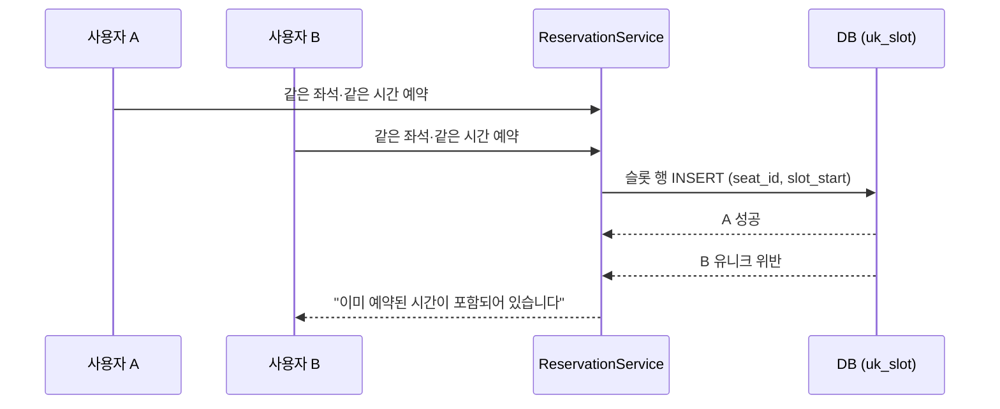
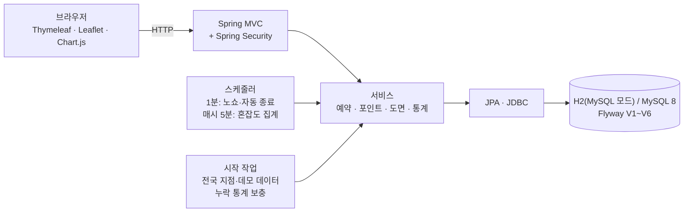

<div align="center">

# StudySeat

**도면에서 좌석을 직접 골라 예약하는 스터디카페 서비스** · 전국 지도 · QR 입실 · 혼잡도 통계


%20%7C%20MySQL%208-4479A1?logo=mysql&logoColor=white)


 

[발표 자료(PDF)](deliverables/StudySeat_발표자료_디자인판.pdf) · [요구사항·기능 명세](docs/01_요구사항_기능명세.md) · [설계(ERD·API)](docs/02_설계_ERD_API.md) · [테스트 결과](docs/03_테스트_결과.md) · [작업일지](docs/04_작업일지.md)

</div>

> 지점·예약·회원·후기 데이터는 모두 **가상(데모)** 입니다. 지점 이름·주소·전화는 예시이고, 지점이 놓인 시·도·시·군·구·읍·면·동만 실제 행정구역입니다.

## 목차
1. [프로젝트 한눈에 보기](#1-프로젝트-한눈에-보기)
2. [프로젝트 소개](#2-프로젝트-소개)
3. [핵심 기능](#3-핵심-기능)
4. [기술적 의사결정과 문제 해결](#4-기술적-의사결정과-문제-해결)
5. [시스템 아키텍처](#5-시스템-아키텍처)
6. [ERD](#6-erd)
7. [API 요약](#7-api-요약)
8. [화면](#8-화면)
9. [테스트와 검증](#9-테스트와-검증)
10. [시작하기](#10-시작하기)
11. [프로젝트 구조](#11-프로젝트-구조)
12. [개발하며 겪은 문제](#12-개발하며-겪은-문제)
13. [한계와 앞으로](#13-한계와-앞으로)
14. [참고](#14-참고)

---

## 1. 프로젝트 한눈에 보기

| 항목 | 내용 |
|---|---|
| 형태 | 개인 토이 프로젝트(1인) · 신입 백엔드 포트폴리오 |
| 기간 | 2026-11-09 시작 |
| 한 줄 소개 | 지점을 지도에서 찾고, 매장 **도면에서 좌석을 눌러 예약**하고, **QR로 입실**하는 스터디카페 서비스. 관리자는 지점별 혼잡도를 본다. |
| 기술 | Java 17 · Spring Boot 4.1.2 · Spring Data JPA · Spring Security(세션) · Thymeleaf · Leaflet(OpenStreetMap) · Chart.js · Flyway · H2(MySQL 모드)/MySQL 8 · JUnit 5 · Gradle |
| 규모 | 가상 지점 약 720곳(실제 시·군·구 256곳 위에 배치) · 좌석 약 1만 5천 석 · 요구사항 38개 · 테이블 14개 |
| 검증 | 자동 시험 **40개 통과**(H2 MySQL 모드) — 동시성 시험 포함 |

## 2. 프로젝트 소개

### 배경
방탈출 카페 예약 서비스 [OBM](https://github.com/chuyj15/OBM)(JSP/Servlet)의 뼈대(시간대 선택 예약, 포인트, 후기, 1:1 문의, 관리자 취소)에서 **아이디어만** 가져와 스터디카페 소재로 바꾸고 Spring Boot로 새로 설계했습니다. 코드는 사용하지 않았습니다.

### 만들면서 바뀐 방향
처음엔 단일 열람실 표 UI였습니다. 피드백을 받을 때마다 구조를 바꿨습니다.

| 피드백 | 조치 |
|---|---|
| "너무 대충 만들었다" | 실제 스터디카페 앱(렛미업·1PP·스터디봄 등)의 소개 문서를 조사해 지점·지도·도면·QR·연장·충전으로 전면 재작성 |
| "서울만 나온다 · 너무 적다" | 전국·실제 행정구역(256개 시·군·구) 기준으로 지점 배치. 모든 시·군·구에 최소 1곳 |
| "AI 느낌이 난다" | Pretendard·Lucide로 교체, 그라데이션을 걷어내고 단색 위주로 정리 |

### 목표 (시험으로 증명한 것)
- 같은 좌석에 **20명이 동시에 예약**해도 1명만 성공 (이중 예약 0건)
- 같은 회원이 여러 좌석을 동시에 예약해도 **포인트 이중 사용 0건**
- 좌석 수만 주면 **건축 도면처럼 배치**하는 도면 엔진 (756가지 조합에서 겹침 0)

## 3. 핵심 기능

| 영역 | 기능 |
|---|---|
| 지점 찾기 | 전국 지도(마커 묶음) + 시·도 칩 + 시·군·구 선택 + 검색, 잔여석·거리순 정렬, 내 지점 등록, 지점별 운영 시간(24시간 지점 포함) |
| 도면 좌석 예약 | 도면에서 좌석 선택, 구역별 시간당 요금, 여성/남성 전용·고정석·퇴실예정석 표시, 시작 60분 전 취소(전액 환불) |
| 입실·이용 | 예약 후 QR + 6자리 코드, 키오스크 시뮬레이터 입·퇴실, +1/+2시간 연장(예약당 1회), 노쇼·자동 종료 |
| 포인트 | 충전(데모 결제)+보너스, **원장** 방식(충전·사용·연장·환불·적립) |
| 후기·문의 | 이용을 마친 예약에 별점 후기 1회, 1:1 문의와 관리자 답변 |
| 관리자 | 지점 실시간 현황, 구역별 시간별·일별 혼잡도 그래프, 누락 통계 보충, 좌석 켜기/끄기, 예약 강제 취소 |

<details>
<summary><b>실제 스터디카페 앱에서 확인한 기능 → StudySeat 구현</b></summary>

| 실제 서비스에서 확인한 기능 | StudySeat |
|---|---|
| 위치 기반 지점 찾기, 자주 가는 지점을 '내 지점'으로 등록 | 전국 지도 + 시·도 칩 + 검색, 잔여석·거리순 정렬, 내 지점 |
| 좌석·스터디룸 현황 실시간 확인 | 도면에 좌석 상태 표시, 지도 마커에 지금 잔여석 |
| 좌석(일반/프리미엄)과 스터디룸마다 요금이 다름 | 구역별 시간당 요금 |
| 이용 시간 연장 | 이용 중 +1/+2시간 연장 |
| QR 코드로 키오스크 입·퇴실 | 예약 후 QR + 6자리 코드, 키오스크 시뮬레이터 |
| 충전 포인트·마일리지 | 포인트 충전(데모 결제) + 보너스, 원장 내역 |
| 지점마다 다른 운영 시간 | 지점별 운영 시간 |

조사한 자료는 앱스토어 소개문·고객센터 문서 수준이라 화면 구성의 세부는 새로 설계했습니다.
</details>

## 4. 기술적 의사결정과 문제 해결

| 문제 | 해결 | 증명 |
|---|---|---|
| 같은 좌석을 두 사람이 동시에 잡으면? | 예약을 **1시간 슬롯 행**으로 쪼개고 `(seat_id, slot_start)` 유니크 제약이 DB 단에서 이중 예약을 거부 | 20명 동시 예약 → 1명 성공·19명 거부, 겹치는 예약 12건 혼합 → 중복 슬롯 0건 |
| 같은 회원이 여러 좌석을 동시에 예약해 포인트를 이중 사용하면? | **회원 행 비관적 락을 트랜잭션 첫 문장으로** + 격리 수준 READ COMMITTED | 잔액 2,000P로 5좌석 동시 예약 → 1건 성공·잔액 0 (락을 빼면 시험이 실패함을 확인) |
| 취소·적립·환불이 두 번 기록되면? | 포인트를 **원장**(쌓기만 함)으로 관리, `(reservation_id, reason)` 유니크 + 예약 행 락 | 같은 예약을 5명이 동시에 취소 → 환불 1건 |
| 연장 후 취소하면 환불은? | 연장분을 `EXTEND`로 따로 기록하고 예약 총 사용액을 환불 | 연장 후 취소 → 잔액 전액 복구 |
| 노쇼·퇴실 누락 | 1분마다 도는 점검이 노쇼/자동 종료 처리(멱등) | 점검을 3회 반복해도 변화 1번 |
| 서버가 꺼져 있던 시간의 통계가 비면? | 시작할 때 시간별(최근 48시간) → 일별(최근 7일) 순서로 **빈 구간만** 보충 | 다시 돌려도 0건, 한 시간만 지우면 그 시간만 복구 |

### 동시 예약이 막히는 흐름


### 핵심 코드 (`ReservationService.reserve`)
```java
@Transactional
public Reservation reserve(Long memberId, Long seatId, LocalDateTime startAt, int hours, LocalDateTime now) {
    // 회원 락을 트랜잭션의 첫 문장으로 잡는다. (MySQL 기본 격리에서 읽기 스냅샷이 먼저 만들어지는 문제 방지)
    Member member = members.findByIdForUpdate(memberId).orElseThrow(...);
    ...
    List<ReservationSlot> rows = new ArrayList<>();
    for (int i = 0; i < hours; i++) {
        rows.add(new ReservationSlot(reservation.getId(), seatId, startAt.plusHours(i)));
    }
    try {
        slots.saveAllAndFlush(rows);                 // (seat_id, slot_start) 유니크 제약이 겹침을 거부
    } catch (DataIntegrityViolationException e) {
        throw new SeatTakenException("이미 예약된 시간이 포함되어 있습니다");
    }
    points.use(memberId, reservation.getId(), price, now);
    return reservation;
}
```

### 도면 엔진
좌석 수만 주면 건축 도면처럼 배치합니다(`FloorPlanLayout`). 바깥 벽, **문이 달린 방**(스터디룸), 스터디존·카페존의 칸막이 책상 섬, 사물함, 서비스바, 키오스크, 입구, 카페 테이블. 홀형·도서관형과 각각의 좌우 거울 4스타일로 지점마다 구도가 다릅니다. 좌석이 많든 적든(읍·면의 작은 지점 포함) 벽 안에서 겹치지 않도록 **756가지 조합**을 시험으로 확인합니다.

## 5. 시스템 아키텍처



- 패키지: `config`(보안·시계·스케줄러·시작 작업) · `domain`(엔티티) · `repository` · `service`(규칙) · `web`(컨트롤러·도면 변환)
- 시간은 `Clock`(Asia/Seoul)을 주입하고 서비스 메서드는 `now`를 인자로 받아 **시험에서 시각을 고정**합니다.
- 스키마는 Flyway(V1~V6), JPA는 `ddl-auto: validate`로 일치만 검사합니다. 모든 POST는 CSRF 토큰이 필요합니다.

## 6. ERD

<details>
<summary><b>14개 테이블 ERD 펼치기</b></summary>


</details>

테이블·컬럼 단위 명세: [`deliverables/14_데이터_테이블_명세서.xlsx`](deliverables/14_데이터_테이블_명세서.xlsx) · 설계 결정은 [`docs/02_설계_ERD_API.md`](docs/02_설계_ERD_API.md)

## 7. API 요약

| 구분 | 경로 | 설명 |
|---|---|---|
| 화면 | `GET /`, `/branches`, `/branches/{id}`, `/branches/{id}/book` | 홈, 지점 찾기(지도), 지점 상세, 도면 좌석 선택 |
| 예약 | `POST /reserve`, `/reservations/{id}/checkin·checkout·extend·cancel` | 예약, 입실·퇴실·연장·취소 |
| 회원 | `/my/reservations`, `/my/points`, `/my/inquiries`, `/reviews` | 내 예약, 포인트, 문의, 후기 |
| 키오스크 | `/kiosk`, `/kiosk/checkin`, `/kiosk/checkout` | 예약 코드로 입·퇴실(시뮬레이터) |
| 관리자 | `/admin`, `/admin/seats`, `/admin/reservations`, `/admin/inquiries` | 대시보드·혼잡도, 좌석, 예약 강제 취소, 문의 답변 |
| JSON | `GET /api/branches`, `/api/stats/hourly`, `/api/stats/daily`, `/actuator/health` | 읽기 전용(로그인 불필요) |

전체 목록: [`docs/02_설계_ERD_API.md`](docs/02_설계_ERD_API.md) · [`deliverables/15_API_명세서.xlsx`](deliverables/15_API_명세서.xlsx)

## 8. 화면

| 홈 | 지점 상세 |
|---|---|
|  |  |

| 홀형 도면 (대전 궁동점) | 도서관형 도면 (건대입구점) | 작은 지점 (옹진군 대청면점) |
|---|---|---|
|  |  |  |

| 예약 완료·입실 QR | 포인트 충전·내역 | 키오스크 |
|---|---|---|
|  |  |  |

| 관리자 대시보드 |
|---|
|  |

도면 화면은 실제 독서실·스터디카페 앱의 좌석 선택 화면(벽·칸막이·번호 책상, 2인실·3인실, 키오스크·사물함·휴게실, 선택불가/선택가능/내 예약/퇴실예정석/고정석/여성·남성 전용 범례)을 참고해 만들었습니다.

## 9. 테스트와 검증

`./gradlew test` — **40개 시험, 실패 0, 건너뜀 0** (H2 MySQL 모드)

| 시험 클래스 | 개수 | 검증 내용 |
|---|---:|---|
| `ReservationConcurrencyTest` | 3 | 20명 동시 예약, 겹치는 예약 12건 혼합, 정책 위반 거부 |
| `LifecycleTest` | 9 | 포인트 동시 사용, 동시 취소, 체크인·노쇼·자동 종료, 후기, 통계 보충 |
| `FeatureTest` | 14 | 연장, 키오스크, 지점별 운영 시간, 구역별 가격, 도면 상태, 내 지점, 충전, 좌석 규칙 |
| `FloorPlanLayoutTest` / `FloorPlanRelayoutTest` | 4 / 2 | 756가지 조합에서 좌석·시설이 벽 안에서 겹치지 않음 |
| `NationwideSeederTest` / `NationwideSeedingTest` | 6 / 1 | 전국 지점 분포 규칙, 저장 결과 |
| `SchemaMigrationTest` | 1 | Flyway V1~ 적용 후 테이블·지점 확인 |

**시험이 실제로 문제를 잡는지 확인:** 예약 코드의 회원 행 잠금(`findByIdForUpdate`)을 일부러 일반 조회로 바꾸자 "같은 회원 동시 예약" 시험이 **실패**했고, 되돌리자 통과했습니다.

화면·HTTP는 실행 중인 앱에서 직접 눌러 보며 확인했고, 그때 발견한 문제는 [테스트 결과 문서](docs/03_테스트_결과.md)에 정리했습니다.

## 10. 시작하기

필요한 것: JDK 17 (Gradle wrapper 포함, 인터넷 필요 — 지도 타일과 Chart.js·Leaflet·QR 라이브러리를 CDN에서 받습니다)

```bash
./gradlew bootRun        # Windows: gradlew.bat bootRun   →  http://localhost:8080
./gradlew test           # 시험 40개
```

- 기본은 파일 없는 H2(MySQL 모드)로 뜨고 **매번 새 데이터**로 시작합니다. 시작할 때 전국 지점 약 680곳(좌석 약 1만 5천 석)과 오늘 앞뒤 시간대 예약(약 1.9만 건), 지난 3일 통계를 JDBC 배치·SQL 집합 연산으로 만들어 지도와 그래프가 채워져 보입니다. 앱이 뜨고 데이터가 채워지기까지 약 15~25초 걸립니다(`studyseat.demo=false`로 끔).
- MySQL을 쓰려면 환경변수 `DB_URL`(예: `jdbc:mysql://localhost:3306/studyseat`), `DB_USER`, `DB_PASSWORD`를 지정합니다(스키마는 Flyway).
- 체험 계정(로컬 데모용): 일반 회원 `demo / demo1234`, 관리자 `admin / admin1234`. **실서비스에 올릴 때는 반드시 없애거나 바꿔야 합니다.**

## 11. 프로젝트 구조

```
src/main/java/com/studyseat/
  config/        보안 · Clock · 스케줄러 · 시작 작업
  domain/        엔티티 (지점·구역·좌석·예약·슬롯·원장·후기·문의 …)
  repository/    JPA 저장소 (회원·예약 행 잠금 조회 포함)
  service/       예약 · 포인트 · 도면 엔진 · 통계 · 전국 시더 …
  web/           컨트롤러 · 도면 변환 · JSON API
src/main/resources/
  db/migration/  Flyway V1~V6
  templates/     Thymeleaf 화면      static/  CSS · JS · 로고
  data/          행정구역 데이터(admin_areas.csv)
src/test/        자동 시험 40개
tools/           지점·도면 시드 생성기, 산출물·스크린샷 도구
docs/            기획 · 요구사항 · 설계 · 테스트 결과 · 작업일지
deliverables/    산출물(PDF · 엑셀) · 발표 PPT · 스크린샷
```

## 12. 개발하며 겪은 문제

실행해서 직접 확인하며 발견하고 고친 것들입니다. (자세한 목록: [테스트 결과 문서](docs/03_테스트_결과.md))

| 문제 | 원인과 해결 |
|---|---|
| 키오스크 입·퇴실 버튼이 브라우저에서 거부될 상황 | 폼에 CSRF 토큰이 없었음 → `th:action`으로 토큰이 들어가게 수정 |
| 로그인하지 않고 큰 페이지(도면)를 열면 오류 | 응답이 나간 뒤 CSRF 토큰 때문에 세션을 만들려다 실패 → 비로그인에게는 예약 폼을 렌더링하지 않음 |
| 구역 이름이 지점마다 "일반석"인데 유니크 제약이 막음 | 구역 이름 유니크를 지점 안에서만 유효하도록 변경 |
| `planH`·`posX` 같은 필드가 컬럼 매핑 실패 | 이름이 대문자 한 글자로 끝나면 Spring 이름 변환이 밑줄을 넣지 않음 → `@Column`으로 컬럼명 지정 |
| 홍대점 부스·건대 라운지 좌석이 겹침 | 생성기에 겹침 검사를 넣고 배치 수정 → 이후 도면 엔진 시험(756가지)으로 확대 |
| 구역 이름표가 도면 위 책상과 겹쳐 보임 | 이름표를 도면 위쪽 "구역·요금" 칩으로 이동 |
| 전남·광주 통합 지역 이름이 둘로 갈라짐 | 이름 변환표에 빠져 있었음 → 보완 |
| 행정동 이름의 쉼표(두류1,2동)가 CSV 읽기 실패 | 가운뎃점으로 바꾸고 읽기 쪽이 형식 오류를 바로 알리게 함 |

## 13. 한계와 앞으로

- 시험은 **H2(MySQL 모드)에서만** 돌렸습니다. MySQL 8 실제 서버에서의 락·격리 동작은 확인하지 못했습니다.
- 결제는 데모입니다(실제 PG 연동 없음). 키오스크도 QR 리더 대신 코드 입력 시뮬레이터이며 단말 인증이 없습니다.
- 혼잡도는 "예약된 슬롯" 기준이며 실제 착석 센서 값이 아닙니다.
- 컨트롤러·템플릿 같은 웹 계층 자동 시험은 없고, 실행 중인 앱에 대한 HTTP·브라우저 확인으로만 검증했습니다.
- 모바일 화면은 반응형 CSS로 만들었지만 실제 휴대폰 폭에서는 직접 확인하지 못했습니다.
- 다음: MySQL 8 검증, Docker Compose, GitHub Actions(빌드+테스트), 웹 계층 시험, 시연 영상

## 14. 참고

- 예약 서비스의 큰 뼈대는 [chuyj15/OBM](https://github.com/chuyj15/OBM)(방탈출 카페 예약, JSP/Servlet)의 아이디어에서 착안했습니다. 코드는 사용하지 않았고, 지점·도면 좌석 예약·동시성 처리·포인트 원장·연장·혼잡도 통계는 새로 설계했습니다.
- 행정구역 데이터: [vuski/admdongkor](https://github.com/vuski/admdongkor) (2026년 10월 기준 행정동 경계) · 지도 데이터 © [OpenStreetMap](https://www.openstreetmap.org/copyright) contributors
- 실제 스터디카페 가맹점 수 6,944곳(2024년 10월): [KB국민카드 분석](https://www.etoday.co.kr/news/view/2423418) — 이 데이터는 그 약 10% 규모의 **모델이며 실측이 아닙니다**.
- 글꼴 [Pretendard](https://github.com/orioncactus/pretendard)(SIL OFL) · 아이콘 [Lucide](https://lucide.dev)(ISC)
