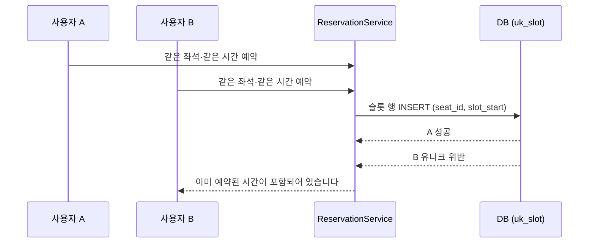
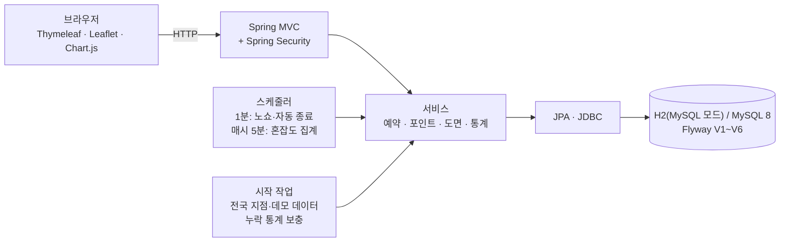

# StudySeat

스터디카페 좌석 예약 서비스입니다. 지점을 지도에서 찾고, 매장 도면에서 자리를 직접 눌러 예약하고, QR 코드로 입실합니다. 혼자 만든 토이 프로젝트이고, 백엔드 포트폴리오용으로 2026년 11월 9일에 시작했습니다.


 

지점 이름, 주소, 전화번호, 예약, 회원, 후기는 전부 가짜 데이터입니다. 지점이 놓인 시·도·시·군·구·읍·면·동만 실제 행정구역입니다.

발표 자료는 [PDF](deliverables/StudySeat_발표자료_디자인판.pdf)로 올려 두었고, 기획·요구사항·설계·테스트 기록은 [docs](docs/) 폴더에 있습니다.

## 목차
- [만든 이유](#만든-이유)
- [기능](#기능)
- [동시에 같은 자리를 누르면](#동시에-같은-자리를-누르면)
- [포인트는 원장으로](#포인트는-원장으로)
- [도면 엔진](#도면-엔진)
- [혼잡도 통계](#혼잡도-통계)
- [구조와 ERD](#구조와-erd)
- [화면](#화면)
- [테스트](#테스트)
- [실행 방법](#실행-방법)
- [폴더 구조](#폴더-구조)
- [개발하면서 막혔던 것](#개발하면서-막혔던-것)
- [아직 못 한 것](#아직-못-한-것)
- [참고](#참고)

## 만든 이유

예약 서비스에서 제일 중요한 건 같은 자리를 두 사람이 동시에 잡지 못하게 하는 것이라고 생각했습니다. 그걸 말로만 설명하지 않고 시험으로 보여 주고 싶어서 이 프로젝트를 시작했습니다.

소재는 방탈출 카페 예약 서비스인 [OBM](https://github.com/chuyj15/OBM)(JSP/Servlet)에서 가져왔습니다. 시간대를 골라 예약하고, 포인트가 있고, 후기와 1:1 문의, 관리자 취소가 있는 흐름이 그대로 스터디카페 좌석 예약에 쓸 만해 보였습니다. 코드는 쓰지 않았고 Spring Boot로 처음부터 다시 설계했습니다.

처음 버전은 열람실 좌석 표 하나가 전부였는데, 보여 주고 나서 너무 대충 만들었다는 지적을 받았습니다. 그래서 렛미업, 1PP, 스터디봄 같은 실제 앱의 소개 문서를 찾아 읽고, 지점과 지도, 도면 좌석 선택, QR 입실, 연장, 충전을 넣어서 다시 만들었습니다. 다음에는 지점이 서울에만 있다는 말을 들어서 전국 행정구역 기준으로 넓혔고, 마지막으로 화면이 AI가 만든 것 같다는 말을 듣고 글꼴과 아이콘을 바꾸고 그라데이션을 걷어냈습니다.

## 기능

- 전국 지도에서 지점을 찾습니다. 시·도와 시·군·구로 좁히거나 이름으로 검색하고, 잔여석 순이나 거리순으로 정렬하고, 자주 가는 지점은 내 지점으로 등록합니다. 지도 마커에는 지금 남은 좌석 수가 보입니다.
- 지점마다 운영 시간과 구역별 시간당 요금이 다릅니다. 홍대점은 24시간 운영입니다.
- 날짜와 시간을 고른 뒤 도면에서 자리를 누르면 예약됩니다. 여성 전용, 남성 전용, 월 이용권 회원 전용(고정석), 바로 앞 시간까지 쓰다 비는 자리(퇴실예정석)가 도면에 따로 표시됩니다.
- 예약하면 QR과 6자리 코드가 나오고, 키오스크 시뮬레이터에서 코드로 입실과 퇴실을 합니다. 이용 중에는 1~2시간 연장할 수 있고(예약당 한 번), 시작 60분 전까지는 전액 환불로 취소됩니다. 입실하지 않으면 노쇼로 처리되고, 퇴실을 안 눌러도 종료 시각에 자동으로 끝납니다.
- 포인트 충전(결제는 데모), 이용 후 후기, 1:1 문의가 있습니다.
- 관리자는 지점 현황과 구역별 혼잡도 그래프를 보고, 좌석을 끄거나 예약을 강제로 취소하고 문의에 답합니다.

## 동시에 같은 자리를 누르면

예약 한 건을 1시간짜리 슬롯 행으로 나눠 저장하고, `reservation_slot` 테이블에 `(seat_id, slot_start)` 유니크 제약을 걸었습니다. 겹치는 시간이 있는지를 코드로 검사하지 않고, 두 번째 INSERT가 제약에 걸려 실패하게 만든 것입니다. 동시에 들어온 요청도 DB가 한 건만 받아 줍니다.



```java
@Transactional
public Reservation reserve(Long memberId, Long seatId, LocalDateTime startAt, int hours, LocalDateTime now) {
    // 회원 락을 트랜잭션 첫 문장으로 잡는다 (MySQL 기본 격리에서 읽기 스냅샷이 먼저 만들어지는 문제 때문)
    Member member = members.findByIdForUpdate(memberId).orElseThrow(...);
    ...
    List<ReservationSlot> rows = new ArrayList<>();
    for (int i = 0; i < hours; i++) {
        rows.add(new ReservationSlot(reservation.getId(), seatId, startAt.plusHours(i)));
    }
    try {
        slots.saveAllAndFlush(rows);   // (seat_id, slot_start) 유니크 제약이 겹침을 거부
    } catch (DataIntegrityViolationException e) {
        throw new SeatTakenException("이미 예약된 시간이 포함되어 있습니다");
    }
    points.use(memberId, reservation.getId(), price, now);
    return reservation;
}
```

시험에서는 같은 좌석, 같은 시간에 20명이 동시에 예약하면 1명이 성공하고 19명이 거부됩니다. 시작 시각이 서로 다른 겹치는 예약 12건을 섞어 돌려도 같은 자리가 두 번 잡힌 경우는 0건이었습니다.

## 포인트는 원장으로

같은 회원이 여러 좌석을 동시에 예약하면 포인트가 이중으로 빠질 수 있습니다. 그래서 `reserve`의 첫 줄에서 회원 행을 비관적 락으로 잠그고, 격리 수준은 READ COMMITTED로 맞췄습니다. 잔액 2,000P로 5개 좌석을 동시에 예약하는 시험에서 1건만 성공하고 잔액은 0이 됩니다. 락을 일부러 일반 조회로 바꿔 보니 이 시험이 실패했고, 되돌리니 다시 통과했습니다. 시험이 정말 문제를 잡는지 확인하려고 한 일입니다.

잔액은 따로 저장하지 않고 `point_ledger`의 합계로 계산합니다. 원장에는 쌓기만 하고(충전, 사용, 연장, 환불, 적립), `(reservation_id, reason)`에 유니크를 걸어서 같은 예약에 환불이나 적립이 두 번 기록되지 않게 했습니다. 같은 예약을 5명이 동시에 취소해도 환불은 한 번만 들어갑니다. 연장은 `EXTEND`로 따로 기록하기 때문에, 연장한 뒤 취소하면 연장분까지 합쳐서 전액이 돌아옵니다.

## 도면 엔진

도면 화면은 실제 독서실·스터디카페 앱의 좌석 선택 화면(벽, 칸막이 책상, 2인실과 3인실, 키오스크, 사물함, 범례)을 참고했습니다. 처음에는 격자 템플릿으로 그렸는데 형태가 너무 밋밋해서, 좌석 수만 넘기면 도면을 만들어 주는 `FloorPlanLayout`으로 바꿨습니다. 바깥 벽과 문이 달린 스터디룸, 칸막이가 있는 책상 섬, 사물함, 서비스바, 키오스크, 입구, 카페 테이블을 놓고, 홀형과 도서관형에 각각 좌우를 뒤집은 것까지 4가지 스타일이 있어서 지점마다 구도가 다릅니다.

좌석이 많든 적든, 읍·면의 작은 지점이든 벽 안에서 겹치지 않아야 해서 756가지 조합을 시험으로 돌립니다. 좌석, 벽, 사물함, 화장실, 서비스바, 키오스크, 창고, 테이블, 입구가 서로 겹치는 조합은 없었습니다.

## 혼잡도 통계

예약 슬롯 수를 사용 가능한 좌석 수로 나눈 점유율을 구역별로 집계합니다. 매시 5분에 직전 시간을 계산하고, 그날 마지막 운영 시간이 끝나면 일별 평균, 최대, 피크 시각도 계산합니다.

서버가 꺼져 있던 시간은 통계가 비어 버리기 때문에, 시작할 때 최근 48시간(시간별)과 최근 7일(일별)을 훑어서 빈 구간만 채웁니다. 시간별 데이터가 하루치 다 있는 날만 일별로 만듭니다. 일부 시간만으로 평균을 내면 틀리기 때문입니다. 이미 있는 구간은 건드리지 않아서 다시 돌려도 변하지 않고, 한 시간만 지워 두면 그 시간만 복구됩니다.

## 구조와 ERD



패키지는 `config`(보안, 시계, 스케줄러, 시작 작업), `domain`(엔티티), `repository`, `service`(업무 규칙), `web`(컨트롤러, 도면 변환)으로 나눴습니다. 시간은 `Clock`(Asia/Seoul)을 주입하고 서비스 메서드가 `now`를 인자로 받게 해서, 시험에서 시각을 마음대로 고정할 수 있습니다. 스키마는 Flyway(V1~V6)가 만들고 JPA는 `ddl-auto: validate`로 맞는지만 봅니다. POST 요청은 전부 CSRF 토큰이 필요합니다.

<details>
<summary>ERD (테이블 14개)</summary>


</details>

컬럼 단위 명세는 [14_데이터_테이블_명세서.xlsx](deliverables/14_데이터_테이블_명세서.xlsx), 설계 결정과 API 목록은 [docs/02_설계_ERD_API.md](docs/02_설계_ERD_API.md)에 있습니다. 화면은 Thymeleaf로 그리고, 지도·마커·혼잡도 그래프에 쓰는 JSON은 `GET /api/branches`, `/api/stats/hourly`, `/api/stats/daily`가 로그인 없이 읽기 전용으로 내려줍니다.

## 화면

| 홈 | 지점 상세 |
|---|---|
|  |  |

| 대전 궁동점(홀형) | 건대입구점(도서관형) | 인천 옹진군 대청면점(작은 지점) |
|---|---|---|
|  |  |  |

| 예약 완료와 입실 QR | 포인트 | 키오스크 |
|---|---|---|
|  |  |  |

| 관리자 대시보드 |
|---|
|  |

## 테스트

`./gradlew test`로 40개를 돌리고, 지금은 전부 통과합니다(H2, MySQL 모드).

| 클래스 | 개수 | 보는 것 |
|---|---:|---|
| ReservationConcurrencyTest | 3 | 20명 동시 예약, 겹치는 예약 12건, 정책 위반 거부 |
| LifecycleTest | 9 | 포인트 동시 사용, 동시 취소, 체크인·노쇼·자동 종료, 후기, 통계 보충 |
| FeatureTest | 14 | 연장, 키오스크, 지점별 운영 시간, 구역별 가격, 도면 상태, 내 지점, 충전, 좌석 규칙 |
| FloorPlanLayoutTest, FloorPlanRelayoutTest | 4, 2 | 756가지 조합에서 도면이 겹치지 않는지 |
| NationwideSeederTest, NationwideSeedingTest | 6, 1 | 전국 지점 분포 규칙, 저장 결과 |
| SchemaMigrationTest | 1 | Flyway 적용 후 테이블과 지점 |

컨트롤러와 템플릿에는 자동 시험이 없습니다. 그쪽은 실행 중인 앱을 직접 눌러 보며 확인했고, 그때 찾은 문제는 [테스트 결과 문서](docs/03_테스트_결과.md)에 적어 두었습니다.

## 실행 방법

JDK 17이 필요합니다. 지도 타일과 Chart.js, Leaflet, QR 라이브러리를 CDN에서 받아 오기 때문에 인터넷도 연결되어 있어야 합니다.

```bash
./gradlew bootRun        # Windows는 gradlew.bat bootRun, 주소는 http://localhost:8080
./gradlew test
```

기본 DB는 파일이 없는 H2(MySQL 모드)이고 실행할 때마다 새 데이터로 시작합니다. 시작하면서 전국 지점 약 680곳(좌석 약 1만 5천 석)과 오늘 앞뒤 시간대의 예약 약 1.9만 건, 지난 3일 통계를 만들기 때문에 화면이 다 채워지기까지 15~25초쯤 걸립니다. 필요 없으면 `studyseat.demo=false`로 끕니다.

MySQL을 쓰려면 `DB_URL`(예: `jdbc:mysql://localhost:3306/studyseat`), `DB_USER`, `DB_PASSWORD` 환경변수를 지정하면 됩니다. 스키마는 Flyway가 만듭니다.

로컬에서 써 볼 계정이 두 개 있습니다. 일반 회원은 `demo / demo1234`, 관리자는 `admin / admin1234`입니다. 데모용이라 실제 서비스에 올린다면 반드시 없애거나 바꿔야 합니다.

## 폴더 구조

```
src/main/java/com/studyseat/
  config/        보안, Clock, 스케줄러, 시작 작업
  domain/        엔티티
  repository/    JPA 저장소 (회원·예약 행 잠금 조회 포함)
  service/       예약, 포인트, 도면 엔진, 통계, 전국 지점 시더
  web/           컨트롤러, 도면 변환, JSON API
src/main/resources/
  db/migration/  Flyway V1~V6
  templates/     Thymeleaf 화면
  static/        CSS, JS, 로고
  data/          행정구역 데이터(admin_areas.csv)
src/test/        자동 시험 40개
tools/           지점·도면 시드 생성기, 산출물·스크린샷 도구
docs/            기획, 요구사항, 설계, 테스트 결과, 작업일지
deliverables/    산출물(PDF·엑셀), 발표 PPT, 스크린샷
```

## 개발하면서 막혔던 것

- 키오스크의 입실·퇴실 버튼이 브라우저에서 거부될 뻔했습니다. 폼에 CSRF 토큰이 없었고, `th:action`을 쓰게 바꿔서 해결했습니다.
- 로그인하지 않은 상태로 도면 같은 큰 페이지를 열면 오류가 났습니다. 응답이 나간 뒤에 CSRF 토큰 때문에 세션을 만들려다 실패하는 것이라, 비로그인 사용자에게는 예약 폼을 아예 그리지 않도록 했습니다.
- 구역 이름 유니크 제약이 지점마다 있는 "일반석"을 막았습니다. 유니크 범위를 지점 안으로 좁혔습니다.
- `planH`, `posX`처럼 대문자 한 글자로 끝나는 필드는 Spring 이름 변환이 밑줄을 넣어 주지 않아 컬럼 매핑이 깨졌습니다. `@Column`으로 컬럼 이름을 직접 적었습니다.
- 홍대점 부스와 건대 라운지에서 좌석이 겹쳤습니다. 생성기에 겹침 검사를 넣었고, 이게 나중에 도면 엔진 시험(756가지)이 됐습니다.
- 도면에서 구역 이름표가 책상 위에 겹쳐 보여서, 도면 위쪽의 "구역·요금" 칩으로 옮겼습니다.
- 전남·광주 통합 지역 이름이 둘로 갈라졌습니다. 이름 변환표에 빠져 있었습니다.
- 행정동 이름의 쉼표(두류1,2동)가 CSV 읽기를 깨뜨렸습니다. 가운뎃점으로 바꾸고, 읽는 쪽이 형식 오류를 바로 알려 주게 했습니다.

## 아직 못 한 것

- 시험은 H2에서만 돌렸습니다. MySQL 8 실제 서버에서 락과 격리 수준이 같게 동작하는지는 확인하지 못했습니다.
- 결제는 데모이고 실제 PG를 붙이지 않았습니다. 키오스크도 QR 리더 대신 코드를 입력하는 시뮬레이터라 단말 인증이 없습니다.
- 혼잡도는 예약된 슬롯 기준이고, 실제로 앉아 있는지는 알 수 없습니다.
- 모바일 화면은 반응형 CSS를 썼지만 실제 휴대폰 크기로는 직접 열어 보지 못했습니다.
- 앞으로 MySQL 검증, Docker Compose, GitHub Actions(빌드와 시험), 컨트롤러 시험, 시연 영상을 해 보려고 합니다.

## 참고

- 예약 서비스의 뼈대는 [chuyj15/OBM](https://github.com/chuyj15/OBM)에서 아이디어를 가져왔습니다. 코드는 쓰지 않았습니다.
- 행정구역은 [vuski/admdongkor](https://github.com/vuski/admdongkor)(2026년 10월 기준 행정동 경계), 지도는 © [OpenStreetMap](https://www.openstreetmap.org/copyright) contributors입니다.
- 전국 스터디카페 가맹점이 6,944곳(2024년 10월, [KB국민카드 분석](https://www.etoday.co.kr/news/view/2423418))이라는 자료를 보고 그 10% 정도 규모로 만들었습니다. 지역별 실제 매장 수는 확인하지 못해서 도심에 많고 읍·면에는 드물게 놓는 규칙으로 정한 모델입니다. 특정 읍·면에 실제로 스터디카페가 있다는 뜻은 아닙니다.
- 글꼴 [Pretendard](https://github.com/orioncactus/pretendard)(SIL OFL), 아이콘 [Lucide](https://lucide.dev)(ISC)
