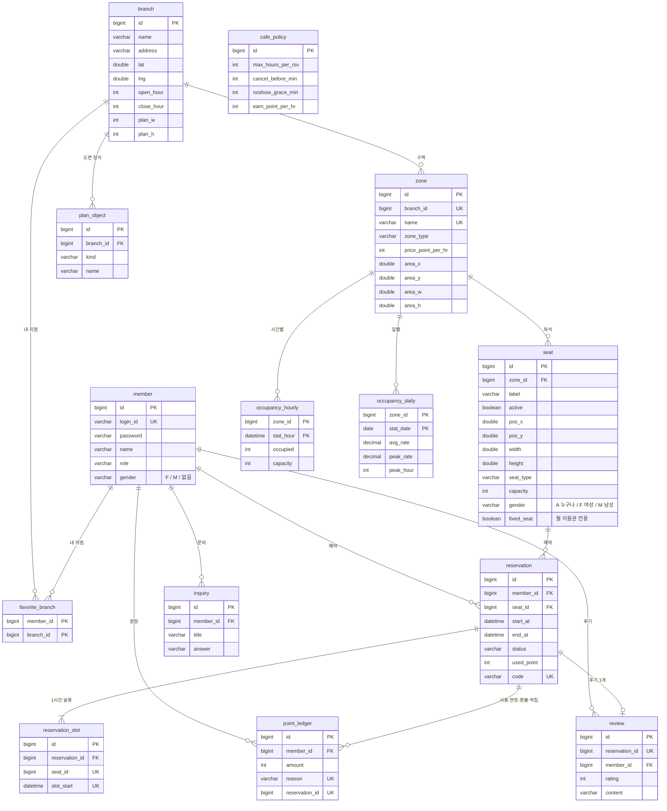

# 설계 — 구성 · ERD · API

## 1. 시스템 구성
```
브라우저 ──(HTML 폼 / JSON)──▶ Spring MVC 컨트롤러 ──▶ 서비스 ──▶ JPA·JdbcTemplate ──▶ H2(MySQL 모드) / MySQL 8
   ▲  Thymeleaf 화면 · Leaflet 지도 · Chart.js              │
   │                                                        └─ 스케줄러: 1분마다 노쇼·자동종료 점검 / 매시 5분 직전 시간 집계
   └─ Spring Security(세션 로그인, 권한 MEMBER / ADMIN)         시작 시: 데모 데이터 + 누락 통계 보충
```
- 패키지: `config`(보안·시계·스케줄러·시작 작업), `domain`(엔티티), `repository`, `service`(규칙), `web`(컨트롤러·도면 변환)
- 시간은 `Clock`(Asia/Seoul)을 주입해 쓰고, 서비스 메서드는 `now`를 인자로 받아 시험에서 시각을 고정할 수 있다.
- 스키마는 Flyway: `V1`(테이블) · `V2`(정책·초기 구역) · `V3`(지점·도면·내 지점·예약 코드 + 강남점) · `V4`(나머지 37개 지점) · `V5`(좌석 성별 전용·고정석, 회원 성별, 도면 시설 키오스크·사물함) · `V6`(도면 배치 버전 `layout_ver`). 도면 위치는 도면 엔진 `FloorPlanLayout`이 만들고(32 x 20 칸, 홀형·도서관형 x 좌우 거울 4스타일), 앱이 뜰 때 `FloorPlanService`가 버전 2 미만인 지점(V3·V4의 초기 격자 배치)을 좌석 수·번호·속성은 그대로 두고 새 도면으로 다시 배치한다. 런타임 시더로 만드는 전국 지점은 처음부터 엔진 배치다. `V3`/`V4`의 도면 데이터는 `tools/gen_branches.py`가 만든다(좌석이 구역을 넘치면 실패). 앱이 시작할 때 만드는 전국 지점(`NationwideSeeder`)은 실제 읍·면·동 위에 지점을 놓는다(`tools/gen_admin_areas.py`가 만든 CSV 사용).
- JPA는 `ddl-auto: validate`로 스키마와 엔티티 일치만 검사한다. (이름이 대문자 한 글자로 끝나는 필드 `planW`·`posX` 등은 Spring 이름 변환이 밑줄을 넣지 않아 `@Column`으로 컬럼명을 지정했다.)

## 2. ERD

(`reservation_slot`의 `seat_id + slot_start`, `point_ledger`의 `reservation_id + reason`, `zone`의 `branch_id + name`은 각각 복합 유니크 키)

### 설계 결정
| 결정 | 이유 |
|---|---|
| 예약 1건을 1시간 슬롯 행으로 쪼갬 | 시간 구간 겹침 검사를 앱 코드가 아니라 `(seat_id, slot_start)` 유니크 제약이 맡아, 동시 요청도 DB가 한 건만 받아준다 |
| 지점마다 운영 시간(`open_hour`~`close_hour`) | 24시간 지점(0~24)과 일반 지점을 같은 코드로 처리. 통계 집계·보충도 지점 운영 시간을 따른다 |
| 구역마다 시간당 가격 | 일반석·프리미엄 부스·스터디룸 요금이 다르다. 예약 금액 = 구역 가격 × 시간 |
| 도면 좌표를 DB에 저장(격자 칸 단위) | 화면은 좌표를 퍼센트로 바꿔 그리기만 한다. 지점마다 배치가 다르고, 좌석 상태만 서버가 계산해 색을 입힌다 |
| 성별 전용·고정석을 좌석 속성(`gender`, `fixed_seat`)으로 둠 | 도면에서는 선택 못 하게 그리고, 예약 서비스(`ReservationService.checkSeatAllowed`)가 같은 규칙을 한 번 더 검사해 직접 요청도 막는다. 일반석 번호 규칙(8로 나눠 1·2=여성, 8의 배수=남성, 10으로 나눠 4=고정석)은 V5 SQL과 시더가 같다 |
| 취소 시 슬롯 삭제, 노쇼 시 첫 슬롯만 유지 | 취소는 자리를 완전히 열고, 노쇼는 이미 시작한 첫 시간을 막은 채 이후 시간만 푼다(그 시간의 혼잡도 통계도 유지됨) |
| 포인트 원장 + 잔액은 합계 | 잔액 컬럼을 따로 고치지 않아 이력과 어긋날 수 없고, 환불·적립·연장 중복을 유니크 인덱스로 막는다 |
| 연장은 `EXTEND`로 따로 기록, 예약당 1회 | `(예약, 사유)` 유니크를 그대로 활용. 취소 환불은 예약의 총 사용액(`used_point`) 기준 |
| 회원 행·예약 행에 비관적 락 | 같은 회원의 동시 예약(포인트 이중 사용), 같은 예약의 동시 취소/체크인/연장을 한 줄로 세운다 |
| 통계는 PK 기준 갱신 후 없으면 삽입 | 같은 구간을 다시 계산해도 행이 늘지 않는다(멱등) |
| 시간별 → 일별 순서로 보충, 일별은 하루치 시간별이 다 있을 때만 | 일부 시간만으로 평균을 내면 부정확하기 때문 |

## 3. 화면 · API

### 화면 (HTML)
| 메서드 | 경로 | 권한 | 설명 |
|---|---|---|---|
| GET | `/` | 모두 | 홈: 로고·검색·전국 현황·바로가기·내 지점·지금 여유 있는 지점·지역 칩·이용 방법·후기 |
| GET | `/branches` | 모두 | 지점 찾기: 지도 + 지점 카드(시·도 칩·시·군·구·검색·잔여석순·거리순). `?sido=대전&q=둔산`으로 미리 필터 |
| GET | `/branches/{id}` | 모두 | 지점 상세: 요금표, 지금 잔여, 시간대별 혼잡도, 편의시설, 위치, 후기 |
| POST | `/branches/{id}/favorite` | 회원 | 내 지점 등록/해제 |
| GET | `/branches/{id}/book?date&start&hours` | 모두 | 날짜·시간을 고르고 도면에서 좌석 선택 |
| POST | `/reserve` | 회원 | 예약 `seatId, branchId, date, start, hours` → 예약 상세로 이동 |
| GET | `/reservations/{id}` | 본인 | 예약 상세: QR·코드, 남은 시간, 입실·퇴실·연장·취소 |
| POST | `/reservations/{id}/checkin` · `/checkout` · `/extend` · `/cancel` | 본인 | 입실 / 퇴실 / 연장(`hours`=1~2) / 취소 |
| GET | `/my/reservations` | 회원 | 이용 중·예정·지난 이용 |
| GET | `/my/points` · POST `/my/points/charge` | 회원 | 잔액·내역 / 충전(`amount`=10000·30000·50000·100000, 데모) |
| GET·POST | `/reviews` | GET 모두 / POST 회원 | 후기 목록 / 작성 `reservationId, rating, content` |
| GET·POST | `/my/inquiries` | 회원 | 1:1 문의 |
| GET·POST | `/signup` · `/login` · POST `/logout` | 모두 | 가입 / 로그인 / 로그아웃 |
| GET·POST | `/kiosk` · `/kiosk/checkin` · `/kiosk/checkout` | 모두(데모) | 키오스크 시뮬레이터: 예약 코드로 입·퇴실 |
| GET | `/admin` · POST `/admin/backfill` | 관리자 | 지점 실시간 현황 + 구역별 혼잡도 대시보드 / 누락 통계 수동 보충 |
| GET | `/admin/seats` · POST `/admin/seats/{id}/toggle` | 관리자 | 좌석 켜기/끄기 |
| GET | `/admin/reservations` · POST `/admin/reservations/{id}/cancel` | 관리자 | 최근 예약 100건 / 강제 취소(환불) |
| GET | `/admin/inquiries` · POST `/admin/inquiries/{id}/answer` | 관리자 | 문의 목록 / 답변 |

POST 요청은 모두 CSRF 토큰이 필요하다(Thymeleaf 폼이 자동 삽입). 규칙 위반(겹침·포인트 부족·시간 초과 등)은 예외를 잡아 화면 상단에 메시지로 보여준다.
로그인하지 않은 사용자에게는 예약 폼 자체를 렌더링하지 않는다(큰 페이지에서 CSRF 토큰이 응답 뒤에 세션을 만들려다 실패하는 것을 막기 위해).

### JSON (읽기 전용, 로그인 불필요)
| 경로 | 응답 |
|---|---|
| `GET /api/branches` | `[{id, name, address, lat, lng, openNow, freeSeats, totalSeats, level(OK/BUSY/FULL/CLOSED), minPricePerHour}]` |
| `GET /api/stats/hourly?zoneId&date` | `[{hour, occupied, capacity, rate}]` |
| `GET /api/stats/daily?zoneId&days` | `[{date, avgRate, peakRate, peakHour}]` (어제까지 최근 N일, 1~31) |
| `GET /actuator/health` | 상태 확인 |

## 4. 스케줄·시작 작업
| 작업 | 주기 | 내용 |
|---|---|---|
| 예약 점검 `sweep` | 1분 | 노쇼 처리, 이용 종료 시각이 지난 이용 자동 종료·적립 |
| 직전 시간 집계 | 매시 5분 | 방금 끝난 시간을 구역별로 집계(지점 운영 시간만), 그날 마지막 운영 시간이면 일별도 집계 |
| 시작 작업 | 앱 시작 시 1회 | (데모) 계정·전국 지점(실제 읍·면·동 위에 가상 지점) 생성·오늘 앞뒤 시간대 예약·지난 3일 통계 합성 → 누락 통계 보충(시간별 48시간 → 일별 7일) |
